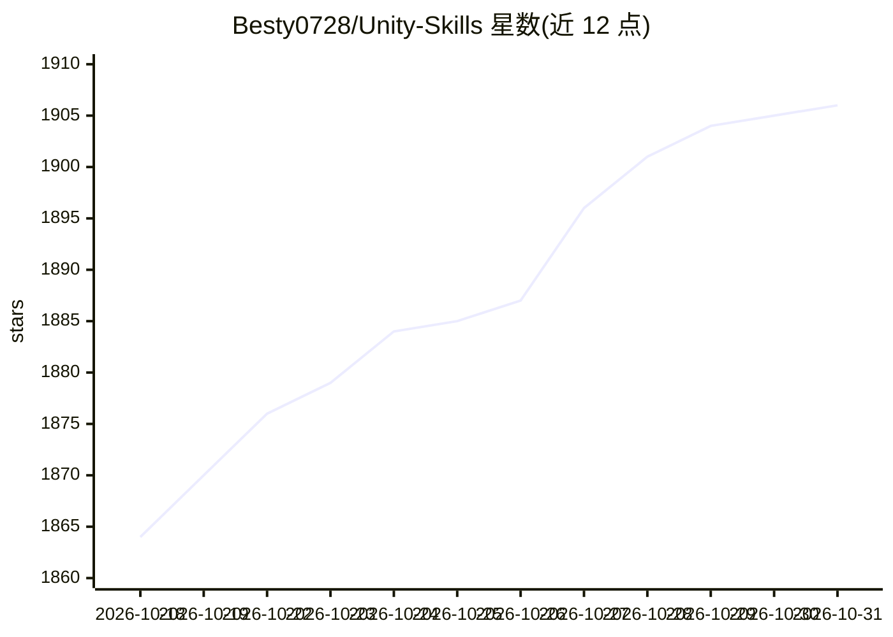

# Besty0728/Unity-Skills

⭐ 1,906 · C# · MIT · 推送 2026-10-30 · [GitHub](https://github.com/Besty0728/Unity-Skills) · [官网](https://www.micostar.cc) · 个人维护 · 中文 README

**供 AI 控制Unity编辑器的 REST Skills 引擎**

面向 Unity 开发者的编辑器自动化引擎：以 Unity 插件形式安装（UPM Git URL），在编辑器内启动 REST 服务，向 AI 编程终端提供 839 个 Skills（54 类操作 + 29 个咨询模块），覆盖场景、YooAsset、HybridCLR 等操作。支持 Claude Code、Codex、Cursor、Antigravity、Kimi Code、OpenCode 六类终端一键安装，内置三级权限模式、dryRun/plan 预演、JSONL 审计日志、快照回滚与批量事务。维护基线为 Unity 2022.3+，由个人维护、基于 unity-mcp 概念重构。

## 筛选速览

| 维度 | 判定 | 备注 |
|---|---|---|
| AI 角色 | `ai-ecosystem` | LLM/agent 周边工具 |
| 许可风险 | `permissive` | MIT |
| 部署形态 | `desktop` | 安装包/桌面程序 |
| 模型依赖 | locked-api |  |
| 硬件要求 | — | 无带数字的原话,不猜 |
| 安装摩擦 | `low` | 无编译、无系统依赖或容器化 |
| 成熟度 | — | 结构信号不足 |

## 能力要点

- 839 个 REST Skills（54 类 + 29 咨询模块），支持批量事务与失败回滚
- 三级权限模式（Approval/Auto/Bypass）+ 风险元数据门控 + Allowlist
- dryRun/plan 执行前预演、JSONL 全量审计、五类持久化快照回滚
- 六类 AI 终端（Claude Code/Codex/Cursor/Antigravity/Kimi Code/OpenCode）一键安装 Skills

## 适用场景

- 让 Claude Code/Cursor 等 AI 终端直接操作 Unity 场景与资源
- AI 自动化执行 YooAsset/HybridCLR 等热更新构建流程
- 需要权限管控与审计的团队内 AI 辅助 Unity 开发

## 场景标签

 · 领域:游戏开发/开发工具

## 证据(README 行号)

> L10:  REST API-based AI-driven Unity Editor Automation Engine
> L42: - 🤖 **6 Major IDEs Native Support**: Claude Code / Antigravity / Codex / Cursor / OpenCode / Kimi Code — one-click 

## 星数曲线

2026-10-18 1,864 → 2026-10-31 1,906（+42）

---
*卡片 v1 · prompt 1.4 · 生成 2026-10-21 · 置信度 high · 依据 README sha `e90e042212c8` · [字段定义](../../DATASET.md)*
