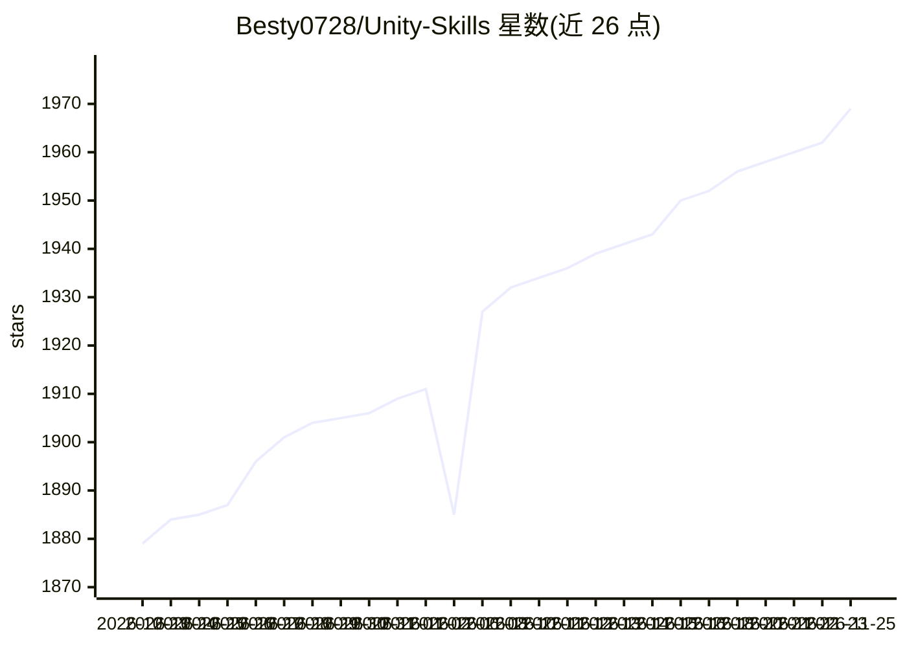

# Besty0728/Unity-Skills

⭐ 1,969 · C# · MIT · 推送 2026-11-23 · [GitHub](https://github.com/Besty0728/Unity-Skills) · [官网](https://www.micostar.cc) · 组织维护 · 中文 README

**让 AI 代理通过 REST 接口直接操作 Unity 编辑器的技能集**

以 Unity 插件 + REST 服务器形式提供的编辑器自动化引擎：暴露 873 个技能（55 类、57 个源文件）与 30 个咨询设计模块，供 Claude Code、Cursor、Codex 等 6 种 AI 编码代理调用，可在 Unity Package Manager 中以 Git URL 安装，面板内一键启动服务器并配置各代理的技能目录。治理机制包括三级权限模式（Approval/Auto/Bypass）、dryRun/plan 预执行检查、JSONL 审计日志、五类快照与按任务回滚、批量事务操作，要求 Unity 2022.3+。

## 筛选速览

| 维度 | 判定 | 备注 |
|---|---|---|
| AI 角色 | `ai-ecosystem` | LLM/agent 周边工具 |
| 许可风险 | `permissive` | MIT |
| 部署形态 | `desktop` | 安装包/桌面程序 |
| 模型依赖 | — | README 未给出锁定关系 |
| 硬件要求 | — | 无带数字的原话,不猜 |
| 安装摩擦 | `low` | 无编译、无系统依赖或容器化 |
| 成熟度 | — | 结构信号不足 |

## 能力要点

- 873 个 REST 技能覆盖 55 类编辑器操作，支持批量事务
- 三级权限模式 + 风险元数据门控 + JSONL 审计日志
- dryRun/plan 预执行校验与按任务回滚、五类持久快照
- Claude Code / Antigravity / Codex / Cursor / Kimi Code / OpenCode 一键安装配置

## 适用场景

- 让 AI 编码代理直接创建、修改 Unity 场景和预制体
- 高危编辑器操作需要审批、审计与可回滚保障时
- 同时控制多个 Unity 项目实例的自动化流水线

## 场景标签

`编码 Agent` `工作流自动化` · 领域:效率与自动化

## 证据(README 行号)

> L10:  REST API-based AI-driven Unity Editor Automation Engine
> L39: - 🛠️ **873 REST Skills Toolkit**: 57 source files across 55 categories, plus 30 advisory design modules, with Batch
> L42: - 🤖 **6 Major IDEs Native Support**: Claude Code / Antigravity / Codex / Cursor / OpenCode / Kimi Code — one-click 

## 星数曲线

2026-10-23 1,879 → 2026-11-25 1,969（+90）

---
*卡片 v1 · prompt 1.4 · 生成 2026-11-23 · 置信度 mid · 依据 README sha `92f899242bd1` · [字段定义](../../DATASET.md)*
