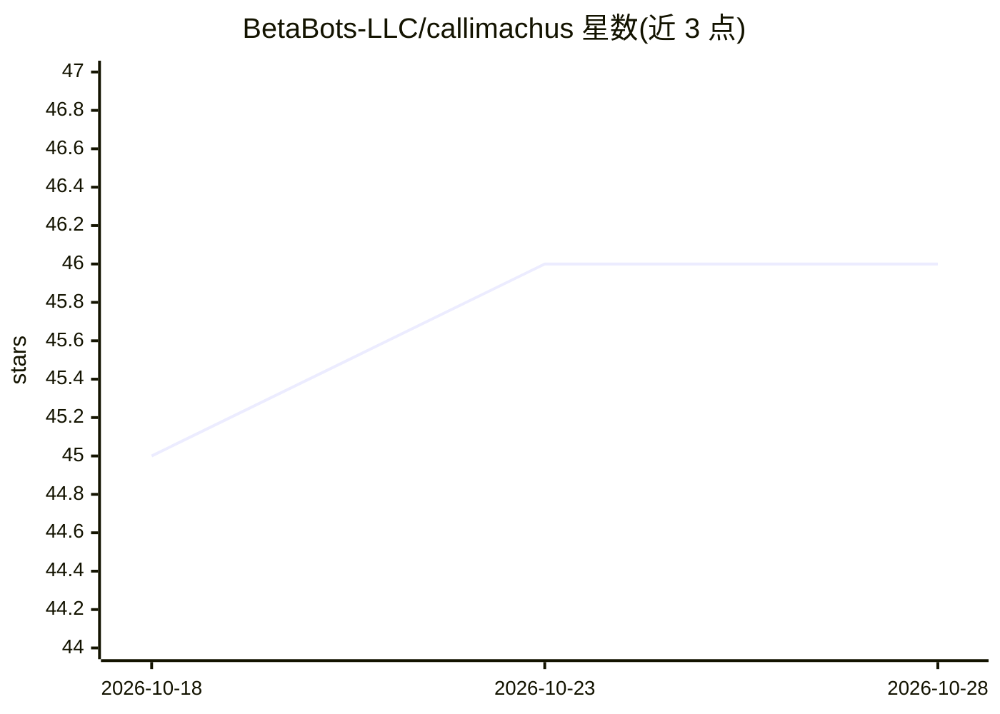

# BetaBots-LLC/callimachus

⭐ 46 · Rust · AGPL-3.0 · 推送 2026-07-14 · [GitHub](https://github.com/BetaBots-LLC/callimachus) · [官网](https://callimachus.app) · 组织维护

**本地索引并检索 11 种 AI 编码代理的对话历史**

基于 Tauri 2 (Rust) + React 19 的桌面应用：将 Claude Code、Codex、Cursor、Gemini CLI、Qwen Code 等 11 种 AI 编码代理的对话线程统一索引到本地 SQLite，支持 BM25 关键词与 sqlite-vec 端侧语义向量混合检索；提供 CLI（cal）、MCP 服务器（21 个读写工具）与 VS Code / Cursor 扩展，多入口读取同一 index.db。另含多供应商应用内聊天、RAG 历史问答、TODO/决策蒸馏、线程-提交关联与项目记忆（写入 AGENTS.md/CLAUDE.md）。数据全部保留在本机，API 密钥存于系统钥匙串。macOS 的"Open in CLI"/"Resume"功能在其他平台暂不支持；Cline/Roo/Kilo 仅索引不可恢复。

## 筛选速览

| 维度 | 判定 | 备注 |
|---|---|---|
| AI 角色 | `ai-ecosystem` | LLM/agent 周边工具 |
| 许可风险 | `dual` | AGPL-3.0 |
| 部署形态 | `desktop` | 安装包/桌面程序 |
| 模型依赖 | local-ok | 支持本地模型 |
| 硬件要求 | — | 无带数字的原话,不猜 |
| 安装摩擦 | `low` | 无编译、无系统依赖或容器化 |
| 成熟度 | — | 结构信号不足 |

## 能力要点

- 11 种 AI 编码代理历史统一进本地 SQLite，FTS5+BM25 与 sqlite-vec 端侧语义混合排序
- 同一索引可经 CLI、MCP 服务器（21 个工具）、VS Code/Cursor 扩展访问
- 多供应商聊天（Anthropic/OpenAI/Gemini/OpenRouter/Ollama/CLI 订阅），支持无 key 的本地 Ollama 与已登录 CLI
- 项目记忆写入 AGENTS.md/CLAUDE.md 并可注入 Claude Code hook

## 适用场景

- 跨多个 AI 编码工具找回过去的对话、决策与解决方案
- 让 agent 在会话中通过 MCP 检索自己的历史工作
- 按项目沉淀决策、gotcha 与 TODO 形成可复用记忆
- 统计各线程的 token 用量与费用估算

## 场景标签

`RAG` `语义搜索` `Agent 记忆` · 领域:Agent 开发

## 证据(README 行号)

> L10: > **Local index & search for your AI coding-agent threads** — across **11 tools** (Claude Code, Codex, Cursor, Gemi
> L20: - **Indexes** every conversation from 11 coding agents into one local SQLite store — Claude Code, Codex, Cursor, Ge
> L37: - **Surfaces to your agents** — a bundled MCP server (`callimachus-mcp`) exposes the index as tools any agent can c

## 星数曲线

2026-10-18 45 → 2026-10-28 46（+1）

---
*卡片 v1 · prompt 1.4 · 生成 2026-10-25 · 置信度 high · 依据 README sha `f19bd5ad873f` · [字段定义](../../DATASET.md)*
