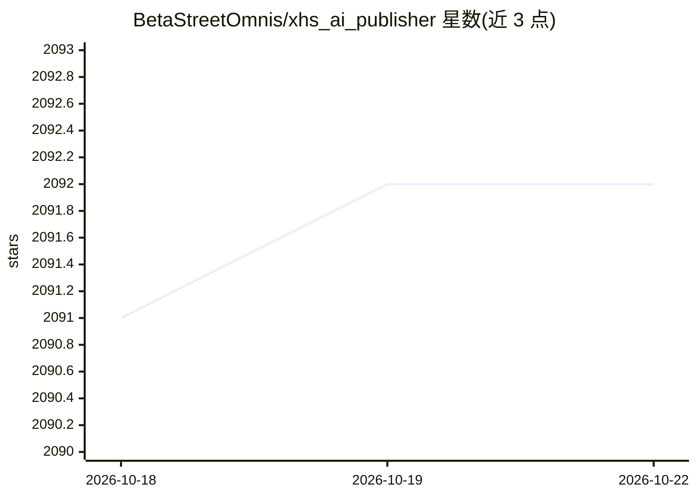

# BetaStreetOmnis/xhs_ai_publisher

⭐ 2,092 · Python · Apache-2.0 · 推送 2026-10-20 · [GitHub](https://github.com/BetaStreetOmnis/xhs_ai_publisher) · [官网](https://xhs-ai-publisher.pages.dev/) · 个人维护 · 中文 README

**小红书笔记的本地 AI 写稿、排版与发布工具**

面向小红书内容创作者的本地桌面工具：输入主题后调用可配置的模型（OpenAI 兼容/Claude/Ollama，未配置回退内置方案）生成标题与正文，经 humanizer-chinese 规则润色，再按 13 款模板排版封面与多页内容图。发布侧基于 Playwright 浏览器自动化，支持登录态保存与导入、预览、定时发布，并提供 FastAPI Web/API 与 Docker 服务模式（端口默认仅绑定本机，远程需令牌）。README 明确列有限流/封号风险与多项使用限制，建议以写稿预览为主、发布前人工核对。

## 筛选速览

| 维度 | 判定 | 备注 |
|---|---|---|
| AI 角色 | `ai-native` | 本体是模型或模型工具 |
| 许可风险 | `permissive` | Apache-2.0 |
| 部署形态 | `self-host` | docker 或自建部署 |
| 模型依赖 | local-ok | 支持本地模型 |
| 硬件要求 | — | 无带数字的原话,不猜 |
| 安装摩擦 | `low` | 无编译、无系统依赖或容器化 |
| 成熟度 | `idea` | |

## 能力要点

- AI 生成标题/正文，支持 OpenAI 兼容/Claude/Ollama 接口配置，未配置回退内置方案
- 13 款封面/内容图模板，本地排版生成封面+多页图文
- 登录态保存/从 Chrome 导入，Playwright 自动化发布与定时任务
- FastAPI Web/API 服务模式与 Docker 部署，默认仅本机访问，远程需 Bearer 令牌

## 适用场景

- 在小红书发布前用 AI 生成并润色笔记初稿
- 用模板自动排版封面和多页内容图
- 管理多账号登录态并预览、定时发布笔记

## 场景标签

`AI 写作` `图像生成` `浏览器自动化` · 领域:效率与自动化

## 证据(README 行号)

> L41: 这是一个在电脑上写小红书笔记的工具。输入主题生成初稿，再改正文、选封面、做内容图，都可以在同一个界面里完成。模型和文案模板可以自己配置。默认文案按素材写，不强制凑字数或加收藏引导；测评需要实际体验记录。模型不可用时只预览原文。
> L88: - 🔧 **自定义模型**: 支持配置 OpenAI 兼容/Claude/Ollama 等接口用于内容生成（未配置则回退到内置方案）

## 星数曲线

2026-10-18 2,091 → 2026-10-22 2,092（+1）

---
*卡片 v1 · prompt 1.4 · 生成 2026-10-21 · 置信度 high · 依据 README sha `d8f294e72291` · [字段定义](../../DATASET.md)*
