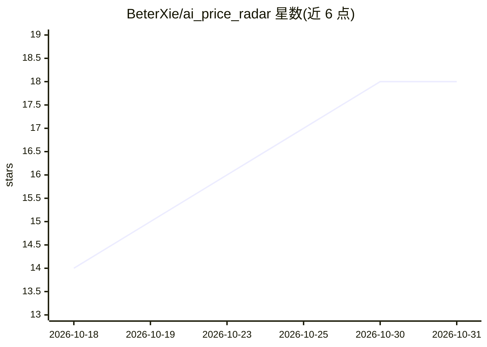

# BeterXie/ai_price_radar

⭐ 18 · Python · MIT · 推送 2026-10-30 · [GitHub](https://github.com/BeterXie/ai_price_radar) · [官网](https://ai.pricememo.cn/) · 个人维护 · 中文 README

**面向 AI 订阅商品的公开报价聚合与比价平台**

从公开店铺自动发现并扫描 AI 订阅类商品（ChatGPT、Claude、Gemini、Grok、Cursor 等），经标准化、分类、同款指纹聚合后，通过网页目录、公开 API 与 Atom Feed 提供带来源链接的比价与价格历史。技术栈为 Next.js 15 + FastAPI + PostgreSQL，爬虫用 Playwright，Docker Compose 部署，含 SQLite 校验与快照原子切换。仅处理公开商品信息，不做交易，不存储卡密与订单数据；不绕过 CAPTCHA/WAF，遇验证需人工完成。

## 筛选速览

| 维度 | 判定 | 备注 |
|---|---|---|
| AI 角色 | `ai-knowledge` | 知识聚合/清单类 |
| 许可风险 | `permissive` | MIT |
| 部署形态 | `self-host` | docker 或自建部署 |
| 模型依赖 | — | README 未给出锁定关系 |
| 硬件要求 | — | 无带数字的原话,不猜 |
| 安装摩擦 | `low` | 无编译、无系统依赖或容器化 |
| 成熟度 | — | 结构信号不足 |

## 能力要点

- Playwright 自动发现店铺并周期扫描（库存 10 分钟/店铺每小时/新店 12 小时）
- 同款指纹聚合跨店铺重复报价，仅可比报价参与主最低价计算
- LDXP、Dujiao-Next 与商家 Feed 多来源快照原子切换，失败保留上一份目录
- 提供公开 API、纠错流程、商家回应与广告/中转站后台管理

## 适用场景

- 比价购买 ChatGPT/Claude/Grok 等 AI 订阅账号套餐
- 追踪某 AI 商品的历史价格与库存变化
- 商家通过提交店铺或 JSON Feed 收录自己的商品报价

## 场景标签

`网页抓取` · 领域:效率与自动化

## 证据(README 行号)

> L6: 面向 AI 订阅商品的开源公开报价聚合平台。项目从公开店铺发现商品，完成标准化、分类、库存与价格更新，并通过可核验来源的网页目录提供比价能力。
> L14: - 聚合 ChatGPT、Codex、OpenAI API、Claude、Gemini、Grok、X Premium 等公开商品报价

## 星数曲线

2026-10-18 14 → 2026-10-31 18（+4）

---
*卡片 v1 · prompt 1.4 · 生成 2026-10-30 · 置信度 mid · 依据 README sha `de9f696ef1de` · [字段定义](../../DATASET.md)*
