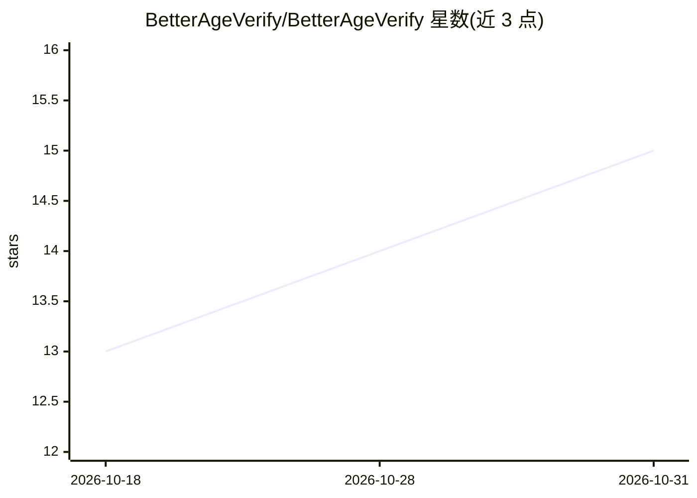

# BetterAgeVerify/BetterAgeVerify

⭐ 15 · Python · NOASSERTION · 推送 2026-02-03 · [GitHub](https://github.com/BetterAgeVerify/BetterAgeVerify) · 组织维护

**本地运行的人脸年龄估计与验证系统，面向儿童安全场景**

基于 Python/PyTorch 的开源人脸年龄估计系统，采用 WideResNet、DEX、ViT 三模型投票集成，宣称 ±2 年准确率 96.3%，处理时延 <500ms。图像在易失性内存中处理并在 1 秒内删除，不长期存储生物特征数据，支持本地/本地部署运行，无需 API key 或云服务。提供摄像头、静态图、视频三种演示脚本及 Python/Flask/React 集成示例。采用自定义 'No More Data!' 许可证 v1.0，禁止用代码构建永久生物特征库。由 luvaary 开发、BetterAgeVerify 组织持有，Roadmap 显示生产加固阶段仍在进行中，移动 SDK 与浏览器版本为规划项。

## 筛选速览

| 维度 | 判定 | 备注 |
|---|---|---|
| AI 角色 | `ai-native` | 本体是模型或模型工具 |
| 许可风险 | `none` | NOASSERTION |
| 部署形态 | `library` | 以包/库形式分发 |
| 模型依赖 | — | README 未给出锁定关系 |
| 硬件要求 | — | 无带数字的原话,不猜 |
| 安装摩擦 | `low` | 无编译、无系统依赖或容器化 |
| 成熟度 | — | 结构信号不足 |

## 能力要点

- 三模型投票集成（WideResNet/DEX/ViT）年龄估计
- 图像易失性内存处理，1 秒内删除生物特征数据
- 支持本地/本地部署运行，无需云服务与 API key
- 提供摄像头/静态图/视频三种演示脚本

## 适用场景

- 游戏与社交平台注册时做年龄门槛验证（如 COPPA 合规）
- 年龄受限内容、活动签到与线下门禁的年龄核验
- 年龄估计相关的科研与测试

## 场景标签

`人脸识别` · 领域:感知与多模态

## 证据(README 行号)

> L44: * 🧠 **Ensemble AI:** A voting-based logic system using 3 specialized models (WideResNet, DEX, ViT) to minimize bias
> L64: from src.age_estimator import BetterAgeVerifyEstimator

## 星数曲线

2026-10-18 13 → 2026-10-31 15（+2）

---
*卡片 v1 · prompt 1.4 · 生成 2026-10-31 · 置信度 mid · 依据 README sha `25fd04c2e5d7` · [字段定义](../../DATASET.md)*
