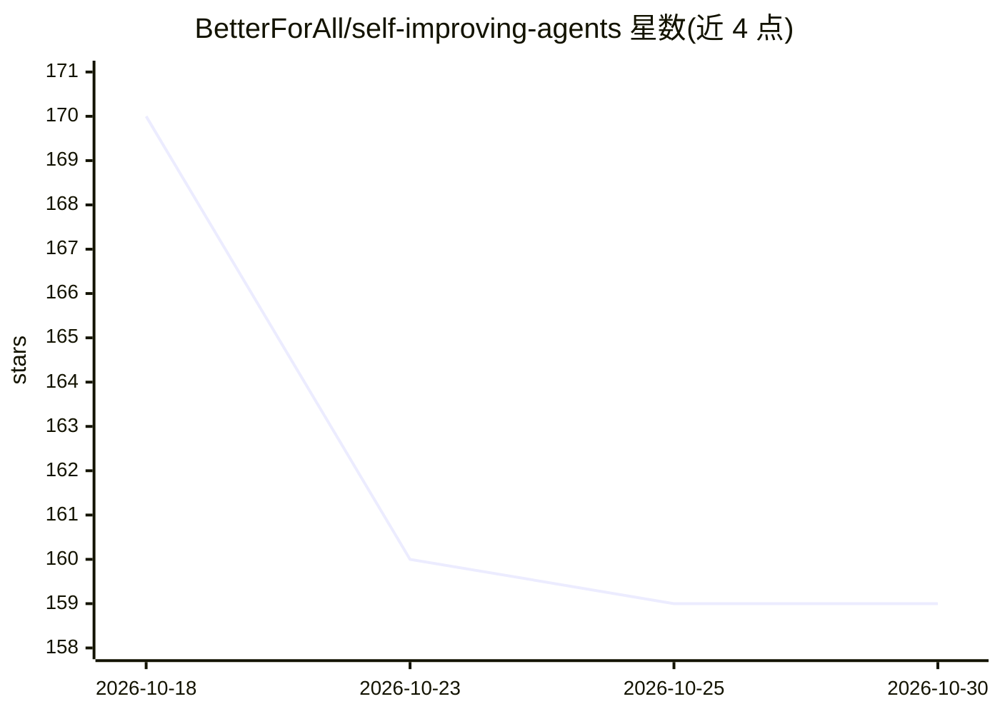

# BetterForAll/self-improving-agents

⭐ 159 · Python · MIT · 推送 2026-04-09 · [GitHub](https://github.com/BetterForAll/self-improving-agents) · 个人维护

**四级自我改进代码 agent 研究框架：从简单循环到对抗演化**

独立研究项目，实现四个递进级别的自我改进代码 agent：L1 基准反馈循环、L2 增加结构化反馈的 reviewer agent、L3 元 agent 重写自身源码（含编译/导入/签名三段校验）、L4 代码与测试 agent 对抗共演化（含 4-agent 锦标赛）。内置 snake、support、email_validation 三个任务，支持自定义任务、checkpoint 断点续跑。使用 Gemini API key，通过 pip 安装依赖后运行。报告了各级别在成本与性能上的实验数据。

## 筛选速览

| 维度 | 判定 | 备注 |
|---|---|---|
| AI 角色 | `ai-ecosystem` | LLM/agent 周边工具 |
| 许可风险 | `permissive` | MIT |
| 部署形态 | `library` | 以包/库形式分发 |
| 模型依赖 | — | README 未给出锁定关系 |
| 硬件要求 | — | 无带数字的原话,不猜 |
| 安装摩擦 | `low` | 无编译、无系统依赖或容器化 |
| 成熟度 | `idea` | |

## 能力要点

- 四级递进架构：反馈循环→结构化反馈→自我代码重写→对抗共演化
- 任务无关框架：三文件（config/initial_solution/benchmark）即可接入自定义任务
- 全级别共享原子写入的 checkpoint 断点续跑模块
- L3 自我重写带编译/导入/签名三段崩溃恢复校验

## 适用场景

- 研究自我改进 agent 的不同架构级别与权衡
- 在自定义代码任务上运行 LLM 自我改进实验
- 观察固定基准与对抗性演化基准下的鲁棒性差异

## 场景标签

`Agent 框架` `编码 Agent` `科研工具` · 领域:Agent 开发

## 证据(README 行号)

> L6: Independent research comparing existing approaches to self-improving code agents
> L196: The framework is task-agnostic. To add a new task, create a folder in `tasks/` with three files:

## 星数曲线

2026-10-18 170 → 2026-10-30 159（-11）

---
*卡片 v1 · prompt 1.4 · 生成 2026-10-23 · 置信度 high · 依据 README sha `4d9633b78245` · [字段定义](../../DATASET.md)*
