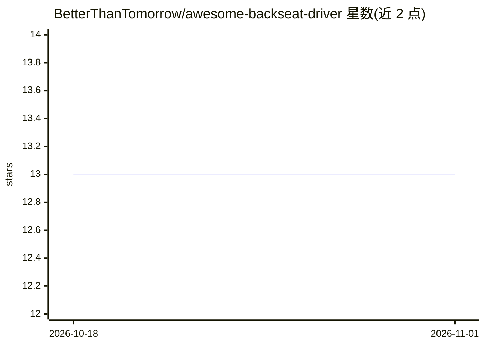

# BetterThanTomorrow/awesome-backseat-driver

⭐ 13 · Clojure · 推送 2026-09-25 · [GitHub](https://github.com/BetterThanTomorrow/awesome-backseat-driver) · 个人维护

**面向 VS Code Copilot/Cursor 的 Clojure AI 插件市场（agents/skills）**

为 GitHub Copilot 与 Cursor 提供的插件市场仓库，内容为 Clojure REPL-first 编程的 agents、skills 与 instructions，围绕 Calva Backseat Driver 的结构化编辑工具构建。含 5 个插件（babashka、clojure、clojure-editor、epupp、squint），插件采用懒加载，仅在被需要时进入上下文。Copilot 清单为源，Cursor 清单由 bb 命令生成。安装方式是将仓库 URL 交给 agent 处理；仓库自述仍处早期原始状态。

## 筛选速览

| 维度 | 判定 | 备注 |
|---|---|---|
| AI 角色 | `ai-knowledge` | 知识聚合/清单类 |
| 许可风险 | `none` | — |
| 部署形态 | `None` |  |
| 模型依赖 | — | README 未给出锁定关系 |
| 硬件要求 | — | 无带数字的原话,不猜 |
| 安装摩擦 | `low` | 无编译、无系统依赖或容器化 |
| 成熟度 | `idea` | |

## 能力要点

- 5 个插件覆盖 Clojure、babashka、squint、浏览器脚本等场景
- 插件内容由 agent 懒加载，不占用上下文窗口
- 双清单工作流：Copilot 清单为源，Cursor 清单自动生成
- 提供 bb validate/publish 校验与发布命令

## 适用场景

- 为 Copilot/Cursor 补充 Clojure 开发的 agent 与技能
- 通过 Backseat Driver 做 REPL-first 的安全编辑委托
- 为 Clojure 项目配置 AI 辅助编辑环境

## 场景标签

`精选清单` `编码 Agent` · 领域:编码与开发

## 证据(README 行号)

> L3: *Plugin marketplace for Clojure AI context in VS Code Copilot and Cursor*: agents, skills, and workflows for REPL-fi
> L6: > Plugins contain agents and skills. Both types of content are lazy loaded by the agent, so they will not hurt your 

## 星数曲线

2026-10-18 13 → 2026-11-01 13（+0）

---
*卡片 v1 · prompt 1.4 · 生成 2026-10-31 · 置信度 high · 依据 README sha `0e28efda2c9e` · [字段定义](../../DATASET.md)*
