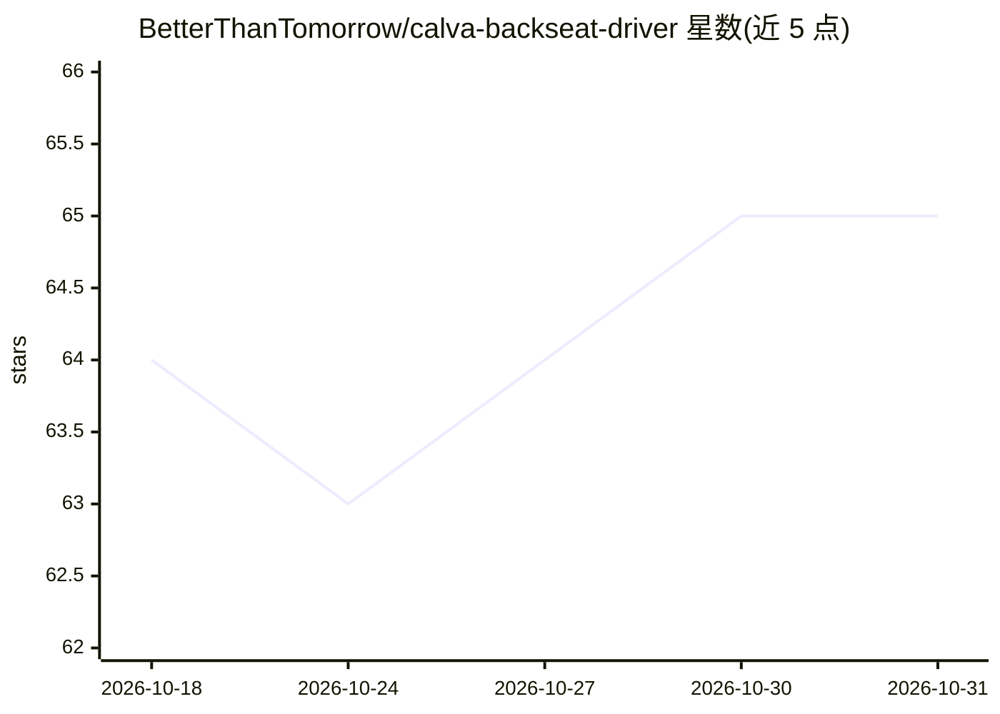

# BetterThanTomorrow/calva-backseat-driver

⭐ 65 · Clojure · MIT · 推送 2026-10-18 · [GitHub](https://github.com/BetterThanTomorrow/calva-backseat-driver) · [官网](https://marketplace.visualstudio.com/items?itemName=betterthantomorrow.calva-backseat-driver) · 个人维护

**给 VS Code AI 助手提供 Calva Clojure 工具的扩展**

VS Code 扩展，将 Calva 的 Clojure 工具暴露给 VS Code AI agent 框架：Copilot 经 VS Code LM Tools 零配置接入，Cursor 经其 add-MCP-server API 接入，其他助手可将其配置为 MCP 服务器（需按项目配置）。工具包括 REPL 代码求值、结构化创建/编辑 Clojure 文件、括号平衡（Parinfer）、文件加载、符号信息与 clojuredocs.org 查询，并以 resources 形式提供技能。求值结果默认限制条目数与嵌套深度以防撑爆上下文。编辑工具无编辑审阅 UI，作者建议借助源代码控制与 Timeline 视图。

## 筛选速览

| 维度 | 判定 | 备注 |
|---|---|---|
| AI 角色 | `ai-ecosystem` | LLM/agent 周边工具 |
| 许可风险 | `permissive` | MIT |
| 部署形态 | `None` |  |
| 模型依赖 | — | README 未给出锁定关系 |
| 硬件要求 | — | 无带数字的原话,不猜 |
| 安装摩擦 | `low` | 无编译、无系统依赖或容器化 |
| 成熟度 | `idea` | |

## 能力要点

- Copilot 与 Cursor 零配置接入，其他助手经 MCP 使用
- REPL 求值、结构化编辑、括号平衡等 Clojure 工具集
- 求值结果按 maxLength/maxDepth 限制以防上下文溢出
- 以 resources/list 与 resources/read 提供 agent 技能

## 适用场景

- 让 Copilot/Cursor 用 REPL 调查并修改 Clojure 代码
- 通过并行子代理同时用 REPL 探索实现方案
- 让其他 MCP 兼容助手进行 Clojure 结构化编辑

## 场景标签

`编码 Agent` · 领域:编码与开发

## 证据(README 行号)

> L9: Backseat Driver gives VS Code AI harnesses access to Calva's Clojure tools these ways:
> L11: 1. **Copilot**: Zero config. (Using **VS Code LM Tools.**).
> L13: 3. **Other AI harnesses**: MCP (Requiring some configuration per project).

## 星数曲线

2026-10-18 64 → 2026-10-31 65（+1）

---
*卡片 v1 · prompt 1.4 · 生成 2026-10-24 · 置信度 high · 依据 README sha `be4c3f992a2d` · [字段定义](../../DATASET.md)*
