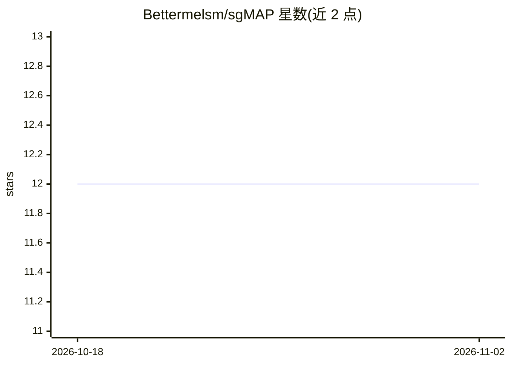

# Bettermelsm/sgMAP

⭐ 12 · Python · 推送 2026-10-08 · [GitHub](https://github.com/Bettermelsm/sgMAP) · 组织维护 · 中文 README

**连接多机 AI 智能体的多智能体协同调度平台**

基于 FastAPI + WebSocket 的多智能体协同平台，由中心 Hub 与分布 Agent 组成：Hub 提供 DAG 任务调度（按 capabilities 匹配路由）、实时看板、API Key 鉴权与文件中转（≤500MB），Agent 负责 LLM 推理（Hermes/Ollama）与实际计算；支持多节点 Peer Mesh 自动发现、Skills 经 GitHub 同步共享、飞书 Bot 内置接入，并提供 Python Agent SDK 与 5 种标准 Role（planner/coder/analyzer/retriever/evaluator）。面向需跨机器编排 AI 智能体的开发者与科研团队，git clone 源码加 pip 安装依赖运行。

## 筛选速览

| 维度 | 判定 | 备注 |
|---|---|---|
| AI 角色 | `ai-ecosystem` | LLM/agent 周边工具 |
| 许可风险 | `none` | — |
| 部署形态 | `library` | 以包/库形式分发 |
| 模型依赖 | local-ok | 支持本地模型 |
| 硬件要求 | — | 无带数字的原话,不猜 |
| 安装摩擦 | `low` | 无编译、无系统依赖或容器化 |
| 成熟度 | — | 结构信号不足 |

## 能力要点

- DAG 调度器按 capabilities 匹配将任务路由到最优节点，支持依赖链
- 多节点 Peer Mesh：自动发现、状态同步、知识广播
- Skills 共享：单节点技能经 GitHub 仓库同步至全平台
- 内置 /api/chat 支持 Ollama 流式推理，飞书 Bot 开箱接入

## 适用场景

- 把分散在多台机器上的 AI 智能体统一接入并调度
- 按 planner/coder/analyzer 等角色组织协作式研究或分析流水线
- 通过飞书等通讯工具向多智能体平台下发任务并查看实时看板

## 场景标签

`Agent 框架` `多智能体` · 领域:Agent 开发

## 证据(README 行号)

> L23: 不是又一个重型 Agent 框架——sgMAP 只做好一件事：**把分散在多台机器上的 AI 智能体连接起来，统一调度，共享知识，协同完成任务。**
> L49: ├── main.py                # Hub 核心：FastAPI + WebSocket，所有 API 端点

## 星数曲线

2026-10-18 12 → 2026-11-02 12（+0）

---
*卡片 v1 · prompt 1.4 · 生成 2026-11-01 · 置信度 mid · 依据 README sha `ee41d8b2deae` · [字段定义](../../DATASET.md)*
