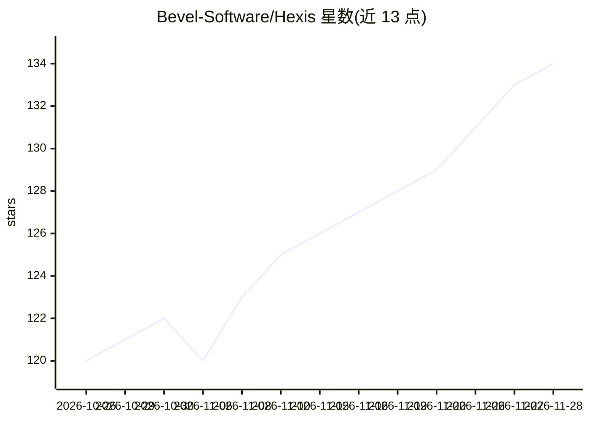

# Bevel-Software/Hexis

⭐ 134 · TypeScript · Apache-2.0 · 推送 2026-11-27 · [GitHub](https://github.com/Bevel-Software/Hexis) · [官网](https://demo.bevel.software/) · 组织维护

**企业级 AI agent 技能/工具/权限集中管控平台**

以 git 仓库为存储层的自托管控制平面：公司的 agent 技能、工具手册、知识上下文与权限以文件形式集中管理，任何人可提议修改，受保护分支需 owner 审批后生效；agent 的权限按文件解析为其运行者的权限，且不持有凭据。通过 MCP 让任意 agent（如 Claude、Cline）发现并加载被批准的技能与上下文，提供角色与访问控制、演示实例、托管实例选项与 Docker 五分钟部署路径。

## 筛选速览

| 维度 | 判定 | 备注 |
|---|---|---|
| AI 角色 | `ai-ecosystem` | LLM/agent 周边工具 |
| 许可风险 | `permissive` | Apache-2.0 |
| 部署形态 | `self-host` | docker 或自建部署 |
| 模型依赖 | — | README 未给出锁定关系 |
| 硬件要求 | — | 无带数字的原话,不猜 |
| 安装摩擦 | `low` | 无编译、无系统依赖或容器化 |
| 成熟度 | — | 结构信号不足 |

## 能力要点

- 技能/工具/上下文/权限以 git 文件存储，审计轨迹即存储层
- 受保护分支的变更需 owner 审批，agent 也可提议技能修复
- 经 MCP 接入任意 agent，按角色控制可见内容
- 自托管运行于自有基础设施，支持自有 SSO

## 适用场景

- 企业内统一管理各部门共享的 agent 技能与知识库
- 让非技术成员也能浏览、提议并审批技能变更
- 控制每个 agent 只能访问其运行者权限范围内的内容

## 场景标签

`知识库管理` `提示工程` · 领域:Agent 开发

## 证据(README 行号)

> L8: **Git-backed control plane for AI-agent skills, tools, context, permissions and
> L12: managed, reviewed and access-controlled, and usable from **any AI agent**. The
> L86: Cline can connect directly to Hexis as a remote Streamable HTTP MCP server.

## 星数曲线

2026-10-26 120 → 2026-11-28 134（+14）

---
*卡片 v1 · prompt 1.4 · 生成 2026-11-28 · 置信度 mid · 依据 README sha `c34c5cc2c378` · [字段定义](../../DATASET.md)*
