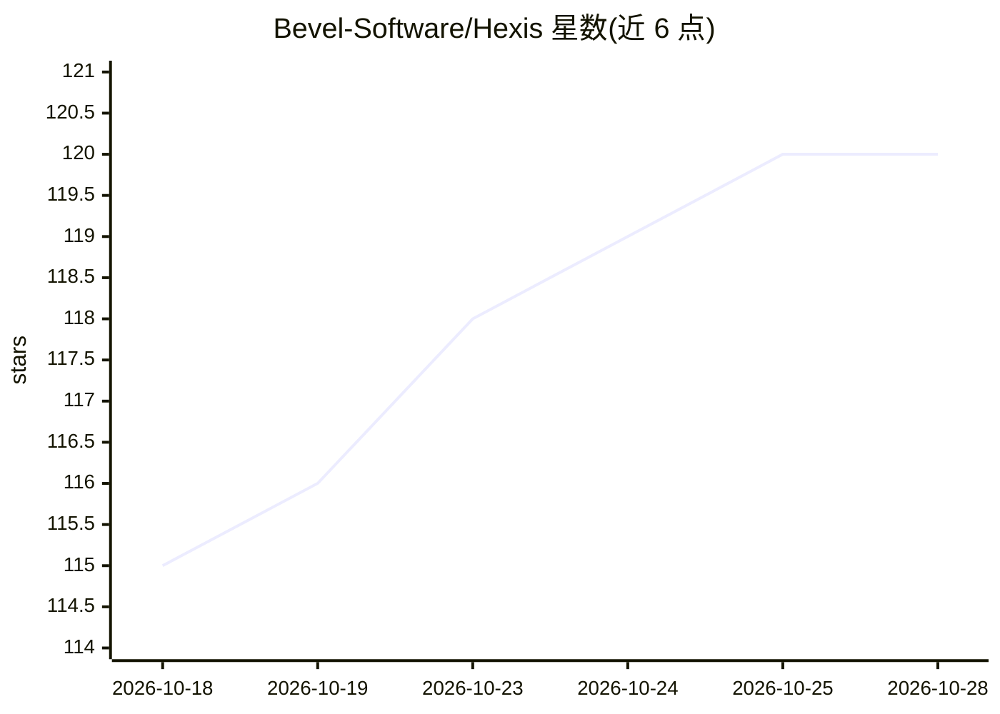

# Bevel-Software/Hexis

⭐ 121 · TypeScript · Apache-2.0 · 推送 2026-10-28 · [GitHub](https://github.com/Bevel-Software/Hexis) · [官网](https://demo.bevel.software/) · 组织维护

**自托管、Git 存储的 AI agent 技能/工具/上下文管理平台**

面向团队与企业的 AI agent 控制平面：将技能、工具手册、知识与权限以文件形式存储在自有 git 仓库，提供变更提议-审批流程、按文件解析的访问控制（agent 权限不超过运行者）与角色管理。通过 MCP 协议供任意 agent（如 Claude、Cline）连接使用。自托管部署基于 Docker Compose，拉取官方镜像、无需本地编译；也可用 pnpm 从源码开发。提供公开 demo 与付费托管实例。

## 筛选速览

| 维度 | 判定 | 备注 |
|---|---|---|
| AI 角色 | `ai-ecosystem` | LLM/agent 周边工具 |
| 许可风险 | `permissive` | Apache-2.0 |
| 部署形态 | `self-host` | docker 或自建部署 |
| 模型依赖 | — | README 未给出锁定关系 |
| 硬件要求 | — | 无带数字的原话,不猜 |
| 安装摩擦 | `low` | 无编译、无系统依赖或容器化 |
| 成熟度 | — | 结构信号不足 |

## 能力要点

- 技能/权限全部为 git 仓库文件，审批与回滚即存储层审计记录
- 受保护分支上的变更提议-审批流程，agent 也可提交修复提议
- 按文件粒度解析权限，agent 权限不超过运行者且不持有凭证
- MCP 接入：任意 agent 经 Streamable HTTP MCP 连接后按角色发现内容

## 适用场景

- 组织内集中管理、评审和分发 AI agent 技能与工具
- 让团队中非技术人员也能浏览、提议和加载插件
- 企业内对 agent 权限与知识访问做细粒度审计控制

## 场景标签

`知识库管理` `提示工程` · 领域:Agent 开发

## 证据(README 行号)

> L8: **Git-backed control plane for AI-agent skills, tools, context, permissions and
> L11: One place where your company's AI plugins, tools and knowledge live: centrally
> L78: Connect Claude to Hexis over MCP, then ask normally. Claude can discover and

## 星数曲线

2026-10-18 115 → 2026-10-28 120（+5）

---
*卡片 v1 · prompt 1.4 · 生成 2026-10-23 · 置信度 mid · 依据 README sha `62879cce5812` · [字段定义](../../DATASET.md)*
