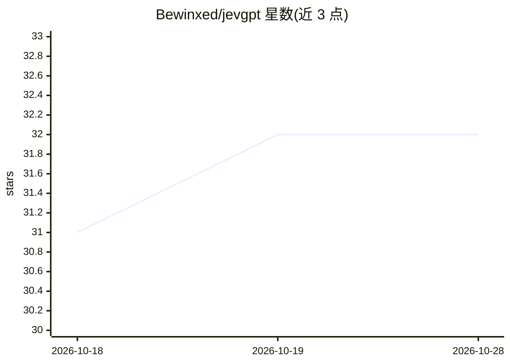

# Bewinxed/jevgpt

⭐ 32 · TypeScript · MIT · 推送 2026-09-17 · [GitHub](https://github.com/Bewinxed/jevgpt) · 个人维护

**用无法生成文本的选择题模型逐词拼出回答的聊天机器人**

JevGPT 是构建在 TypeSafe AI `jev-latest` 决策模型上的聊天客户端。该模型只回答关于 state 的多选题、不能生成文本，JevGPT 以对话记录为 state、以 20,000 词词典为候选、每次问『下一个词是？』，通过 255 词分桶、桶间 run-off、三重重复惩罚等机制逐词解码出回答。提供 REPL 与脚本式对话、录制 JSON 分布。README 记录了实测上限：逐词 top-1 为 7/10，一轮对话约 368 秒、1,092 次 API 调用、成本 $1.13；另有逐字符版本的历史记录。需 TYPESAFE_API_KEY。

## 筛选速览

| 维度 | 判定 | 备注 |
|---|---|---|
| AI 角色 | `ai-native` | 本体是模型或模型工具 |
| 许可风险 | `permissive` | MIT |
| 部署形态 | `None` |  |
| 模型依赖 | — | README 未给出锁定关系 |
| 硬件要求 | — | 无带数字的原话,不猜 |
| 安装摩擦 | `low` | 无编译、无系统依赖或容器化 |
| 成熟度 | — | 结构信号不足 |

## 能力要点

- 在只能做多选题的决策模型上实现自回归逐词生成
- 255 词分桶 + 桶间 run-off 解决跨桶概率不可比问题
- 三重重复惩罚（local/content/stopword）抑制循环输出
- 支持 --record 录制逐词 top-8 分布的 JSON 会话记录

## 适用场景

- 研究非生成式模型的文本生成可行性
- 观察逐词/逐字符解码的完整概率分布
- 作为 API 限制（255 criteria、64k tokens）下的工程实验参考

## 场景标签

`聊天机器人` · 领域:对话与助手

## 证据(README 行号)

> L5: A chatbot built on a model that cannot generate text.
> L7: TypeSafe AI's `jev-latest` is a **decision** model: it does not generate text,
> L8: it only answers multiple-choice questions about a `state`. JevGPT is a chat

## 星数曲线

2026-10-18 31 → 2026-10-28 32（+1）

---
*卡片 v1 · prompt 1.4 · 生成 2026-10-26 · 置信度 high · 依据 README sha `ccda2d4b6ede` · [字段定义](../../DATASET.md)*
