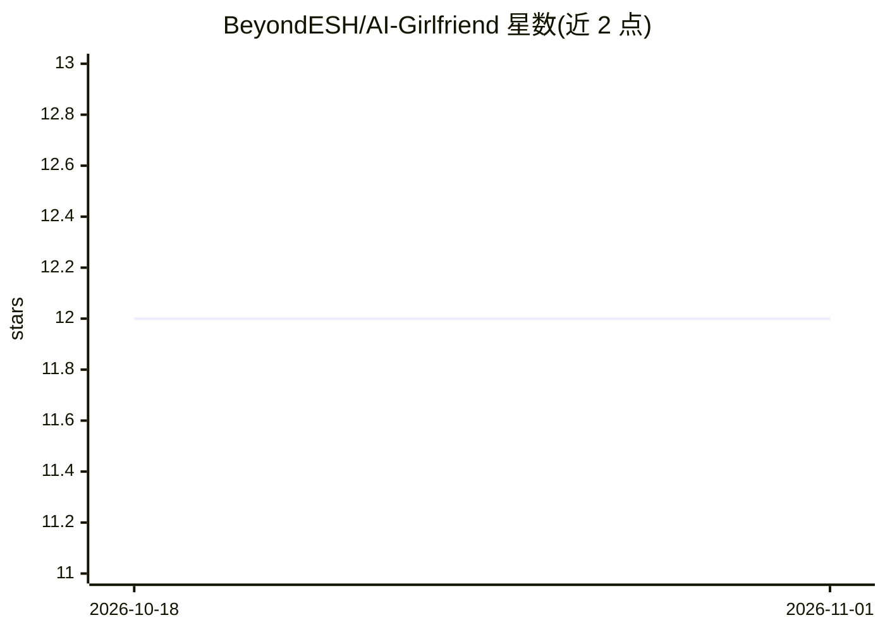

# BeyondESH/AI-Girlfriend

⭐ 12 · QML · 推送 2026-03-12 · [GitHub](https://github.com/BeyondESH/AI-Girlfriend) · 个人维护 · 中文 README

**Qt 桌面端 AI 虚拟伴侣应用：文字/语音对话与声音克隆**

基于 Qt 6 QML 的桌面 AI 虚拟伴侣应用，面向终端用户。集成 FunASR 实时语音识别（2pass 在线+离线模式）、Ollama 本地 LLM 对话（默认 qwen3:8b）与 CosyVoice 零样本语音合成/克隆，支持文字聊天与语音对话两种交互，具备上下文记忆、多会话管理、AI 角色与提示词定制。应用本体需 CMake 从源码构建（Qt 6.8+、CMake 3.16+），三个后端服务需自行部署。许可证限制商用。

## 筛选速览

| 维度 | 判定 | 备注 |
|---|---|---|
| AI 角色 | `ai-native` | 本体是模型或模型工具 |
| 许可风险 | `none` | — |
| 部署形态 | `self-host` | docker 或自建部署 |
| 模型依赖 | local-ok | 支持本地模型 |
| 硬件要求 | — | 无带数字的原话,不猜 |
| 安装摩擦 | `low` | 无编译、无系统依赖或容器化 |
| 成熟度 | — | 结构信号不足 |

## 能力要点

- ASR+LLM+TTS 全链路语音对话，支持文字与语音两种模式
- 基于 CosyVoice 的零样本声音克隆，可上传自定义语音样本
- 同一对话内上下文记忆与多会话历史管理
- 实时监控 Ollama/FunASR/CosyVoice 服务状态并自动重连

## 适用场景

- 在桌面本地运行一个可文字/语音对话的 AI 虚拟伴侣
- 上传自己的语音样本让 AI 用克隆声音回复
- 自定义 AI 角色名称、性格与系统提示词进行个性化对话

## 场景标签

`语音 Agent` · 领域:对话与助手

## 证据(README 行号)

> L3: 一个基于 Qt 6 QML 开发的 AI 虚拟伴侣桌面应用程序，集成了语音识别 (ASR)、大语言模型 (LLM) 和语音合成 (TTS) 功能，支持文字聊天和语音对话两种交互模式。
> L46: - **Ollama** - 本地大语言模型服务 (默认端口: 11434)
> L49: - **FunASR** - 阿里开源语音识别服务 (默认端口: 10096)
> L52: - **CosyVoice** - 语音合成/克隆服务 (默认端口: 50000)

## 星数曲线

2026-10-18 12 → 2026-11-01 12（+0）

---
*卡片 v1 · prompt 1.4 · 生成 2026-11-01 · 置信度 mid · 依据 README sha `934b3e0ba741` · [字段定义](../../DATASET.md)*
