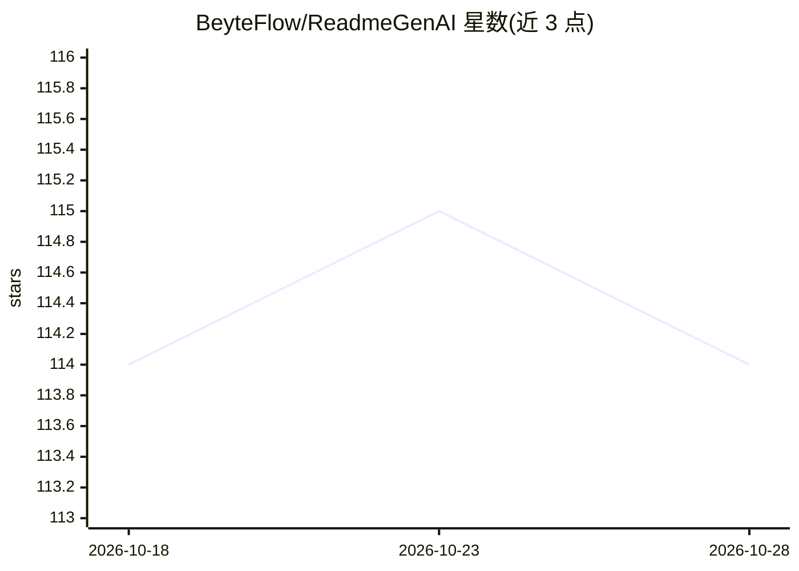

# BeyteFlow/ReadmeGenAI

⭐ 116 · TypeScript · MIT · 推送 2026-10-26 · [GitHub](https://github.com/BeyteFlow/ReadmeGenAI) · [官网](https://readmegen-ai.vercel.app/) · 组织维护

**为 GitHub 仓库用 AI 生成 README.md 的 Web 应用**

基于 Next.js/TypeScript/Node.js 的开源 Web 应用：用户输入仓库 URL，调用 AI 生成结构化、可定制的 README.md（标准 Markdown 输出）。面向希望减少文档编写时间的开发者。本地运行需 Node.js LTS 与 npm/yarn/pnpm，克隆仓库安装依赖后 npm run dev 启动，可能需在 .env.local 配置 AI API key（README 未指明具体模型服务商）。

## 筛选速览

| 维度 | 判定 | 备注 |
|---|---|---|
| AI 角色 | `ai-native` | 本体是模型或模型工具 |
| 许可风险 | `permissive` | MIT |
| 部署形态 | `library` | 以包/库形式分发 |
| 模型依赖 | — | README 未给出锁定关系 |
| 硬件要求 | — | 无带数字的原话,不猜 |
| 安装摩擦 | `low` | 无编译、无系统依赖或容器化 |
| 成熟度 | — | 结构信号不足 |

## 能力要点

- 输入 GitHub 仓库 URL 生成完整 README.md
- 输出为标准 Markdown，可按项目需求定制
- 技术栈：Next.js / TypeScript / Node.js
- 集成 Coderabbit.ai 代码审查

## 适用场景

- 为自己的 GitHub 仓库快速生成初始 README
- 统一多项目的 README 结构与风格

## 场景标签

`AI 写作` · 领域:内容生成

## 证据(README 行号)

> L5:  Instantly generate professional, well-structured README files for your GitHub repositories with AI-powered precisio
> L103: NEXT_PUBLIC_AI_API_KEY=your_ai_api_key_here

## 星数曲线

2026-10-18 114 → 2026-10-28 114（+0）

---
*卡片 v1 · prompt 1.4 · 生成 2026-10-23 · 置信度 high · 依据 README sha `7535b4050426` · [字段定义](../../DATASET.md)*
