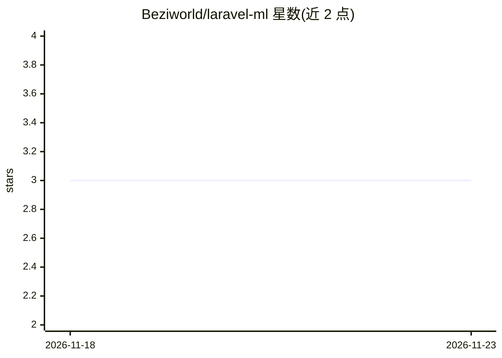

# Beziworld/laravel-ml

⭐ 3 · PHP · MIT · 推送 2026-11-04 · [GitHub](https://github.com/Beziworld/laravel-ml) · [官网](https://beziworld.eu) · 组织维护

**给 Laravel 开发者的 PHP 机器学习包：训练、验证、预测一体化**

基于 Rubix ML 3 引擎的 Laravel 机器学习包，以纯 PHP 运行。提供 Eloquent 查询流式数据集、类形式的模型定义（含 fluent builder）、留出法与 k 折交叉验证及类型化 TrainingReport、带版本管理与回滚的模型持久化、SHA-256+HMAC 签名的模型文件安全加载、队列训练任务、Artisan 命令、验证规则与数据漂移检查；预设覆盖分类、回归、聚类、异常检测、KNN 推荐与文本分类。要求 PHP 8.3+、Laravel 12/13、ext-zlib，Tensor 扩展可选。

## 筛选速览

| 维度 | 判定 | 备注 |
|---|---|---|
| AI 角色 | `ai-native` | 本体是模型或模型工具 |
| 许可风险 | `permissive` | MIT |
| 部署形态 | `None` |  |
| 模型依赖 | — | README 未给出锁定关系 |
| 硬件要求 | — | 无带数字的原话,不猜 |
| 安装摩擦 | `low` | 无编译、无系统依赖或容器化 |
| 成熟度 | — | 结构信号不足 |

## 能力要点

- Eloquent 查询/集合/数组/CSV 直接作数据集，声明式特征类型转换与预处理
- 交叉验证报告：accuracy/precision/recall/F1/MCC/混淆矩阵/MAE/RMSE/R²/silhouette 等
- 模型版本化存储、promote/rollback/prune 与 SHA-256+HMAC 签名校验的安全反序列化
- Apriori 关联规则、队列训练任务、Artisan 命令与夜间数据漂移检查

## 适用场景

- 在 Laravel 应用里训练客户流失预测模型并生成评估报告
- 给订单数据做异常检测、对客户做分群细分
- 做商品相似推荐与'买了X也买Y'关联规则
- 训练垃圾文本/情感分类器并用验证规则接入请求校验

## 场景标签

`推荐系统` · 领域:学习与行业

## 证据(README 行号)

> L7: Laravel-first machine learning in plain PHP. Everything php-ml offered
> L12: - datasets straight from Eloquent (`fromQuery()` streams with `lazy()`), collections, arrays and CSV files
> L15: - presets: classifier, regressor, clusterer, anomaly detector, KNN recommender, text classifier (spam / sentiment)

## 星数曲线

2026-11-18 3 → 2026-11-23 3（+0）

---
*卡片 v1 · prompt 1.4 · 生成 2026-11-22 · 置信度 high · 依据 README sha `1ae533e3ca02` · [字段定义](../../DATASET.md)*
