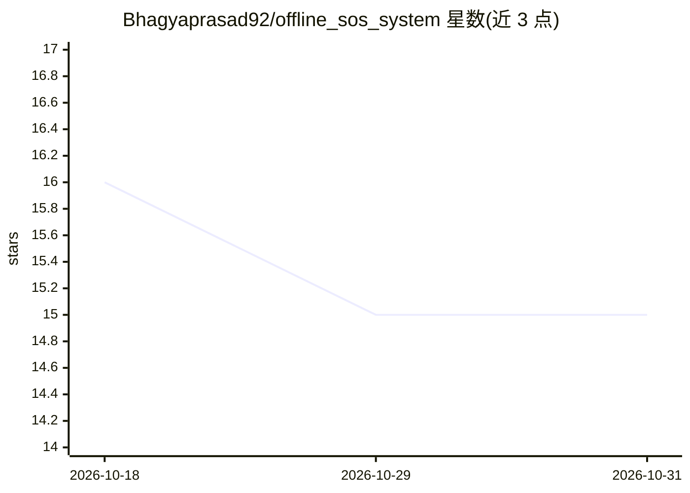

# Bhagyaprasad92/offline_sos_system

⭐ 15 · Dart · MIT · 推送 2026-10-20 · [GitHub](https://github.com/Bhagyaprasad92/offline_sos_system) · [官网](https://pub.dev/packages/offline_sos_system/example) · 个人维护

**离线端侧碰撞检测引擎：Flutter 应用集成的无 UI 安全包**

面向 Flutter 开发者的 headless 安全包：通过设备加速度计与陀螺仪高频遥测数据，在设备端运行内置 TensorFlow Lite 模型（tflite_flutter）检测物理碰撞与异常，全程离线、无需云端。包本身只做推理与数学处理，UI、GPS、短信派发由宿主应用负责。支持注入自定义 .tflite 模型，可配置冲击阈值、置信度门限、启发式回退与重复事件冷却。README 明确说明传感器差异导致的误报/漏报无法完全消除。

## 筛选速览

| 维度 | 判定 | 备注 |
|---|---|---|
| AI 角色 | `ai-native` | 本体是模型或模型工具 |
| 许可风险 | `permissive` | MIT |
| 部署形态 | `None` |  |
| 模型依赖 | — | README 未给出锁定关系 |
| 硬件要求 | — | 无带数字的原话,不猜 |
| 安装摩擦 | `low` | 无编译、无系统依赖或容器化 |
| 成熟度 | — | 结构信号不足 |

## 能力要点

- 设备端 TensorFlow Lite 模型实时处理加速度计/陀螺仪数据
- 100% 离线推理，无云端依赖
- 支持注入自定义 .tflite 模型，含默认模型
- 可配置冲击阈值、置信度、回退阈值与去重冷却

## 适用场景

- 在安全类应用中加入离线碰撞/异常检测能力
- 无网络环境下仍可触发紧急事件检测
- 替换或补充自研的简单阈值碰撞检测逻辑

## 场景标签

`推理引擎` · 领域:训练与推理

## 证据(README 行号)

> L13: **Offline SOS System** revolutionizes application safety. By harnessing **Edge AI** and high-frequency hardware tel
> L16: * 🧠 **Neural Telemetry:** Processes raw hardware data locally through an advanced, bundled TensorFlow Lite (`tflite
> L18: * 🔌 **Decoupled Architecture:** Strictly headless. We handle the complex math and ML; your app handles the UI, GPS,

## 星数曲线

2026-10-18 16 → 2026-10-31 15（-1）

---
*卡片 v1 · prompt 1.4 · 生成 2026-10-31 · 置信度 high · 依据 README sha `0aab39a17e5a` · [字段定义](../../DATASET.md)*
