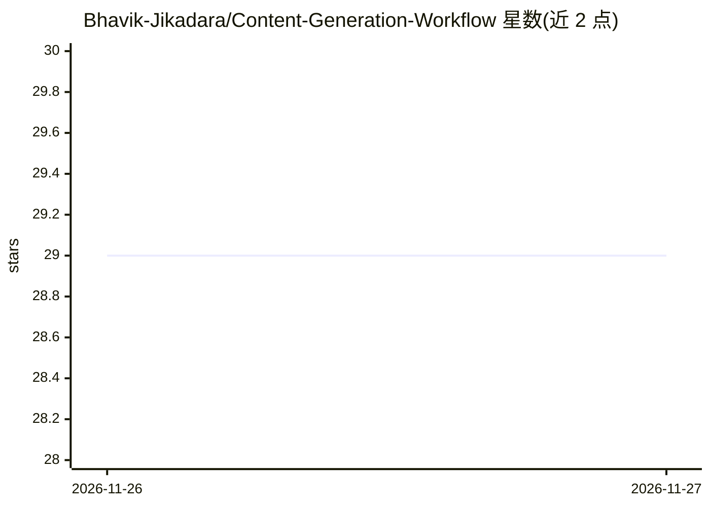

# Bhavik-Jikadara/Content-Generation-Workflow

⭐ 29 · Jupyter Notebook · MIT · 推送 2026-11-25 · [GitHub](https://github.com/Bhavik-Jikadara/Content-Generation-Workflow) · [官网](https://huggingface.co/spaces/bhavikjikadara/ContentGenerationWorkflow) · 个人维护

**基于 CrewAI 的多智能体内容生成工作流演示项目**

使用 CrewAI 框架构建的内容生成工作流：输入主题后由多个分工的 AI agent（研究、写作、SEO）协作完成内容规划、文本生成、图像生成与编辑检查，通过 Streamlit 提供用户界面。README 自述为高层概念示例，需按 CrewAI 框架实际工具集调整后才能使用。运行前需配置 OpenAI、Google、Serper、Hugging Face 四个 API key，以 Python 虚拟环境 + pip 安装依赖后用 streamlit 命令启动。

## 筛选速览

| 维度 | 判定 | 备注 |
|---|---|---|
| AI 角色 | `ai-native` | 本体是模型或模型工具 |
| 许可风险 | `permissive` | MIT |
| 部署形态 | `library` | 以包/库形式分发 |
| 模型依赖 | — | README 未给出锁定关系 |
| 硬件要求 | — | 无带数字的原话,不猜 |
| 安装摩擦 | `low` | 无编译、无系统依赖或容器化 |
| 成熟度 | `idea` | |

## 能力要点

- CrewAI 多 agent 协作：研究、写作、SEO 分工完成内容流程
- Streamlit 提供用户界面，streamlit run Home.py 启动
- 支持 gemini-pro 文本生成与 stable-diffusion-xl-base 图像生成
- 提供在线演示链接与完整安装步骤

## 适用场景

- 输入一个主题自动生成图文并茂的 SEO 文章
- 学习 CrewAI 多智能体协作的端到端项目结构
- 搭建自己的内容生产流水线原型

## 场景标签

`多智能体` `AI 写作` `图像生成` · 领域:Agent 开发

## 证据(README 行号)

> L38: Implement a content generation workflow using the Crew AI framework. This workflow should autonomously process inpu
> L41: * Crew AI framework
> L42: * Streamlit - User Interface(UI)

## 星数曲线

2026-11-26 29 → 2026-11-27 29（+0）

---
*卡片 v1 · prompt 1.4 · 生成 2026-11-26 · 置信度 high · 依据 README sha `55a093d9860b` · [字段定义](../../DATASET.md)*
