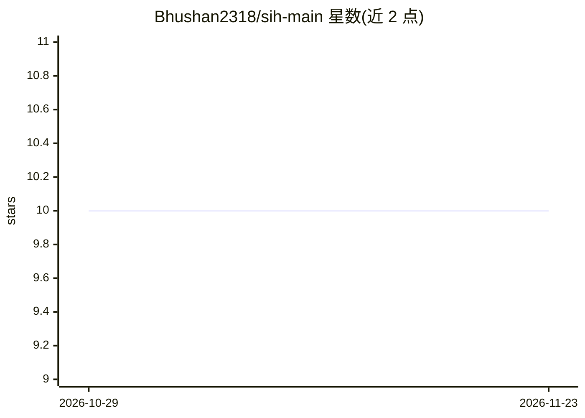

# Bhushan2318/sih-main

⭐ 10 · Python · MIT · 推送 2026-11-02 · [GitHub](https://github.com/Bhushan2318/sih-main) · [官网](https://sanket-a0dd.onrender.com) · 个人维护

**面向印度 666 个区县的中期天气预报失误概率预测系统**

SIH 2026 赛题（MoES）的参赛项目：对 NOAA GEFS 预报，逐区县、逐地面变量、逐 1–10 预报时效预测误差落入历史误差分布 90 分位以上（bust）的概率，并用 SHAP 归因到输入特征。每变量一个 XGBoost 回归器加一个 out-of-fold 训练的 bust 分类器，配七条基线与块 bootstrap 等验证流程；模型在工作站训练后经 promotion gate 发布，512 MB 免费实例只做预计算的静态服务。提供 FastAPI 后端与 React 仪表盘，支持 Kerala 洪水等历史事件回放。

## 筛选速览

| 维度 | 判定 | 备注 |
|---|---|---|
| AI 角色 | `ai-native` | 本体是模型或模型工具 |
| 许可风险 | `permissive` | MIT |
| 部署形态 | `self-host` | docker 或自建部署 |
| 模型依赖 | — | README 未给出锁定关系 |
| 硬件要求 | — | 无带数字的原话,不猜 |
| 安装摩擦 | `low` | 无编译、无系统依赖或容器化 |
| 成熟度 | — | 结构信号不足 |

## 能力要点

- 对 666 区县 × 8 变量 × 10 时效输出 bust 概率并逐条 SHAP 归因
- 七条基线对照、held-out 年份与 10 天间隔防泄漏测试
- 训练与服务分离：工作站训练经 promotion gate 发布，512 MB 实例只服务不训练
- Kerala 洪水、Mumbai 降雨、Cyclone Ockhi/Fani 的事件回放

## 适用场景

- 值班预报员在早晨签发预警前评估当前预报出错概率
- 按区县和时效查看风险排序的告警清单并导出 CSV
- 逐日回放历史天气事件检验模型的当时表现

## 场景标签

`数据分析` · 领域:效率与自动化

## 证据(README 行号)

> L33: India's **666 districts**, **8 surface variables** and **lead days 1 to 10**, Sanket
> L84: 5. **Models.** One XGBoost regressor per variable predicts the size of the forecast's
> L90:  dashboard response ahead of time. A 512 MB free-tier instance serves those files and the

## 星数曲线

2026-10-29 10 → 2026-11-23 10（+0）

---
*卡片 v1 · prompt 1.4 · 生成 2026-11-20 · 置信度 high · 依据 README sha `79a7cd36dc76` · [字段定义](../../DATASET.md)*
