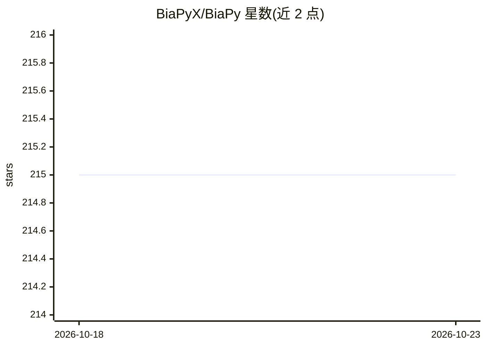

# BiaPyX/BiaPy

⭐ 215 · Jupyter Notebook · MIT · 推送 2026-10-22 · [GitHub](https://github.com/BiaPyX/BiaPy) · [官网](https://BiaPyX.github.io) · 组织维护

**生物图像深度学习工作流库：覆盖分割/检测/去噪等任务**

开源 Python 库与应用，为生物显微图像分析提供常见深度学习工作流，覆盖 2D/3D 语义分割、实例分割、目标检测、图像去噪、超分辨率、自监督学习、图像分类与图像到图像翻译。面向熟练计算机科学研究者与编程经验较少的用户，提供 GUI 与多种访问入口。由来自多个研究机构的 BiaPy 团队开发，论文发表于 Nature Methods，已被多项生物医学研究（CartoCell、MitoEM 基线等）用于方法实现。

## 筛选速览

| 维度 | 判定 | 备注 |
|---|---|---|
| AI 角色 | `ai-native` | 本体是模型或模型工具 |
| 许可风险 | `permissive` | MIT |
| 部署形态 | `library` | 以包/库形式分发 |
| 模型依赖 | — | README 未给出锁定关系 |
| 硬件要求 | — | 无带数字的原话,不猜 |
| 安装摩擦 | `low` | 无编译、无系统依赖或容器化 |
| 成熟度 | — | 结构信号不足 |

## 能力要点

- 覆盖 2D/3D 分割、检测、去噪、超分辨率、分类等 8 类任务
- 提供跨平台桌面 GUI（Windows/Linux/macOS 64 位）
- 基于 PyTorch，经 PyPI 与 conda-forge 发布
- 论文发表于 Nature Methods（2025）

## 适用场景

- 对电镜/荧光显微图像做 3D 实例分割与语义分割
- 生物图像去噪、超分辨率与图像分类工作流
- 不熟悉编程的用户通过 GUI 使用深度学习流程

## 场景标签

`图像视频处理` `目标检测` · 领域:感知与多模态

## 证据(README 行号)

> L31: BiaPy is an open source library and application that streamlines the use of common deep-learning workflows for a la
> L35: This repository is actively under development by the BiaPy Team, a group of contributors from different research in

## 星数曲线

2026-10-18 215 → 2026-10-23 215（+0）

---
*卡片 v1 · prompt 1.4 · 生成 2026-10-22 · 置信度 high · 依据 README sha `778a47eb64c9` · [字段定义](../../DATASET.md)*
