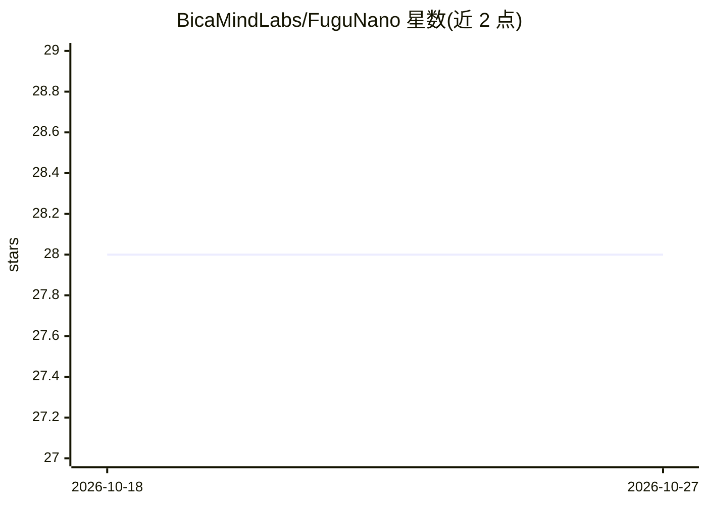

# BicaMindLabs/FuguNano

⭐ 28 · TypeScript · Apache-2.0 · 推送 2026-07-07 · [GitHub](https://github.com/BicaMindLabs/FuguNano) · [官网](https://github.com/LeoLin990405/FuguNano#readme) · 组织维护 · 中文 README

**多 agent 编码编排控制面：让多个编码 agent 组成可审计的证据门控循环**

TypeScript 实现的多 agent 编码控制面，重新实现 Sakana Fugu 的思路但不训练指挥模型。它将已有编码 agent（fugue-cc/Codex/OpenCode/Antigravity 及实验性 qwen-code、kimi-code 等）接入统一的 Harness 端口，组织 plan→dispatch→review→repair→learn 循环，每一步由类型化的证据包（review/incident/guard/certificate）门控；Selector 按 TRUST/TRUST_SPOT_CHECK/ESCALATE 路由 best-of-N 扇出。通过 Self-Harness 演进自身配置，另提供 Electron+React 桌面端 FuguNano Studio。需 macOS/Linux、Node.js≥18.18、git、tmux 及模型凭据。

## 筛选速览

| 维度 | 判定 | 备注 |
|---|---|---|
| AI 角色 | `ai-ecosystem` | LLM/agent 周边工具 |
| 许可风险 | `permissive` | Apache-2.0 |
| 部署形态 | `None` |  |
| 模型依赖 | — | README 未给出锁定关系 |
| 硬件要求 | — | 无带数字的原话,不猜 |
| 安装摩擦 | `medium` | 含编译或系统依赖之一 |
| 成熟度 | — | 结构信号不足 |

## 能力要点

- 统一 Harness 端口接入 4 个核心与多个实验性 agent 运行时
- 类型化证据包（review/incident/guard/动作证书）门控每个流水线环节
- verifier-aware Selector：TRUST/TRUST_SPOT_CHECK/ESCALATE 三态路由扇出结果
- Self-Harness 从运行时证据挖掘失败并只提升无回归的自身配置修改

## 适用场景

- 用多个已有编码 agent 组成有界的编码/审查/修复循环
- 对 best-of-N 多模型输出做基于验证器的可信路由
- 让 harness 从运行证据中自我改进 prompt/记忆/技能配置

## 场景标签

`多智能体` `编码 Agent` `代码审查` · 领域:Agent 开发

## 证据(README 行号)

> L26: FuguNano is a small, training-free control plane for multi-agent coding. It does
> L134: The core only knows one `Harness` port (`dispatch(req) → Result`, `health()`), so
> L141: |Core|`fugue-cc` · `codex` · `opencode` · `agy`|descriptor-backed adapters in the default surface|

## 星数曲线

2026-10-18 28 → 2026-10-27 28（+0）

---
*卡片 v1 · prompt 1.4 · 生成 2026-10-26 · 置信度 high · 依据 README sha `6624947f4b04` · [字段定义](../../DATASET.md)*
