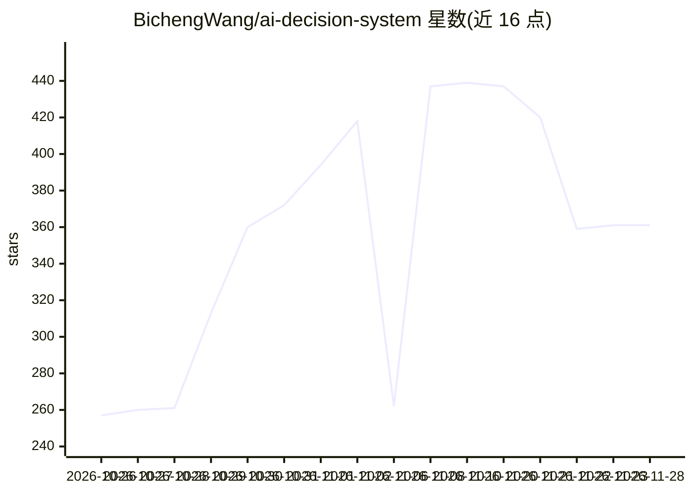

# BichengWang/ai-decision-system

⭐ 361 · Python · MIT · 推送 2026-11-23 · [GitHub](https://github.com/BichengWang/ai-decision-system) · [官网](https://bichengwang.github.io/ai-decision-system/) · 个人维护

**为 AI 决策提供可重放、可离线验证记录的工具集**

面向 AI 辅助 go/no-go 决策的记录工具集，包含四个独立包：jevdecision 生成类型化模型答案与质量门记录，decisioncontrol 冻结路由策略并生成可回放的人工审批记录，expgate 从 A/B 聚合数据产出 SHIP/HOLD/ROLLBACK 决策，RELIA 提供模型发布门验证。三个已发布包仅需 Python 3.11+，运行时仅用标准库；各包相互独立，非一体化运行时。0.2.0 功能（签名、schema、OPA/Cedar 适配器等）尚未发布。

## 筛选速览

| 维度 | 判定 | 备注 |
|---|---|---|
| AI 角色 | `ai-ecosystem` | LLM/agent 周边工具 |
| 许可风险 | `permissive` | MIT |
| 部署形态 | `library` | 以包/库形式分发 |
| 模型依赖 | — | README 未给出锁定关系 |
| 硬件要求 | — | 无带数字的原话,不猜 |
| 安装摩擦 | `low` | 无编译、无系统依赖或容器化 |
| 成熟度 | `idea` | |

## 能力要点

- 四个独立包分别覆盖模型答案、审批、实验晋升与发布门
- 决策记录可离线重放验证（jev-decision-verify、experiment-gate-verify 等 CLI）
- 已发布包运行时仅依赖 Python 标准库
- 支持 in-toto/DSSE、Sigstore（cosign）等签名机制（0.2.0 未发布）

## 适用场景

- 对 AI 辅助的晋升/审批决策留存第三方可复核的证据记录
- 从 A/B 实验导出的聚合数据生成可验证的上线/回滚决策
- 对带标签数据集上的模型答案做质量门与校准评估

## 场景标签

`模型评测` `MLOps` · 领域:评测与运维

## 证据(README 行号)

> L25: These are **independent packages, not one integrated runtime**. The arrows show
> L39: The three small packages require Python 3.11+ and use only the standard library
> L108: These tools complement existing platforms; the bounded contribution is retained,

## 星数曲线

2026-10-26 257 → 2026-11-28 361（+104）

---
*卡片 v1 · prompt 1.4 · 生成 2026-11-25 · 置信度 high · 依据 README sha `3a9f615dfaf8` · [字段定义](../../DATASET.md)*
