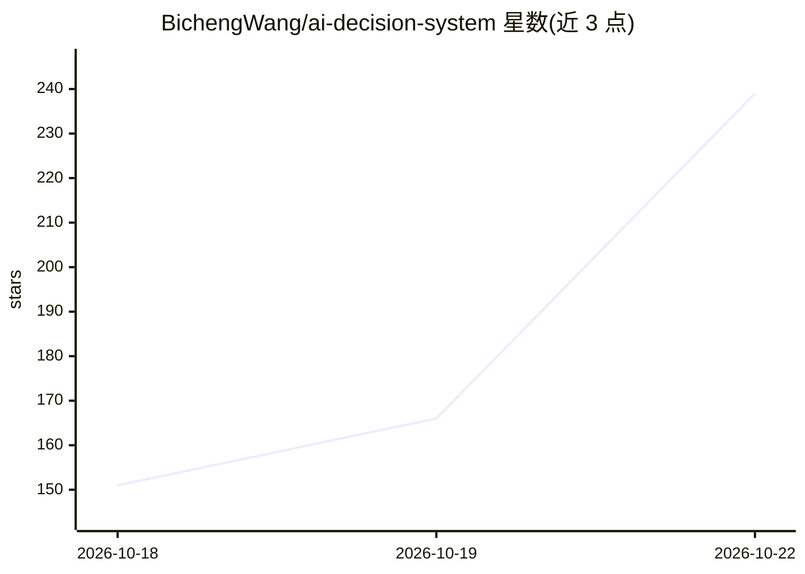

# BichengWang/ai-decision-system

⭐ 239 · Jupyter Notebook · MIT · 推送 2026-10-20 · [GitHub](https://github.com/BichengWang/ai-decision-system) · 个人维护

**AI 辅助 go/no-go 决策的可重放、离线可验证记录工具集**

由三个独立 Python 包（jevdecision、decisioncontrol、expgate）与未发布的 RELIA 组成的仓库，非一体化运行时：jevdecision 对类型化模型答案（是/否、选择、评分）做带标签的质量门控；decision-control 冻结路由策略并记录人工审批，可重放；expgate 从导出的 A/B 聚合数据生成 SHIP/HOLD/ROLLBACK/INVALID 决策记录。每个包发出机器可校验的记录（含 RFC 8785 摘要、可选 DSSE 签名），供第三方离线复核。三个包已发布 0.1.0，仅依赖 Python 3.11+ 标准库；0.2.0 功能未发布。Jev 支持 Jev 与 OpenAI Decisions 后端，需相应 API key。RELIA 未发布且许可状态未确定。

## 筛选速览

| 维度 | 判定 | 备注 |
|---|---|---|
| AI 角色 | `ai-ecosystem` | LLM/agent 周边工具 |
| 许可风险 | `permissive` | MIT |
| 部署形态 | `library` | 以包/库形式分发 |
| 模型依赖 | — | README 未给出锁定关系 |
| 硬件要求 | — | 无带数字的原话,不猜 |
| 安装摩擦 | `low` | 无编译、无系统依赖或容器化 |
| 成熟度 | `idea` | |

## 能力要点

- 四类决策点各自发出机器可校验的离线复核记录
- jev-decision-verify / experiment-gate-verify / decision-control replay 等校验命令
- RFC 8785 摘要与可选签名（DSSE/in-toto、Sigstore via cosign）
- 运行时仅用 Python 标准库，三包 0.1.0 已上 PyPI

## 适用场景

- 为模型晋升/审批/发布决策留档并供第三方离线复核
- 对 LLM 类型化答案做带标签的 PASS/FAIL 质量门控
- 从 GrowthBook 导出的 A/B 聚合数据生成可验证的发布决策

## 场景标签

`模型评测` · 领域:评测与运维

## 证据(README 行号)

> L19: These are **independent packages, not one integrated runtime**. The arrows show
> L28: |Jev decision|Typed yes/no, choice and score answers; labeled quality gates|`jevdecision`|Typed answer, `evaluation
> L108: |Evaluation tools (promptfoo, OpenAI Evals)|Score prompts and model behavior|Jev gates typed answers with explicit

## 星数曲线

2026-10-18 151 → 2026-10-22 239（+88）

---
*卡片 v1 · prompt 1.4 · 生成 2026-10-22 · 置信度 high · 依据 README sha `098a3269fb9a` · [字段定义](../../DATASET.md)*
