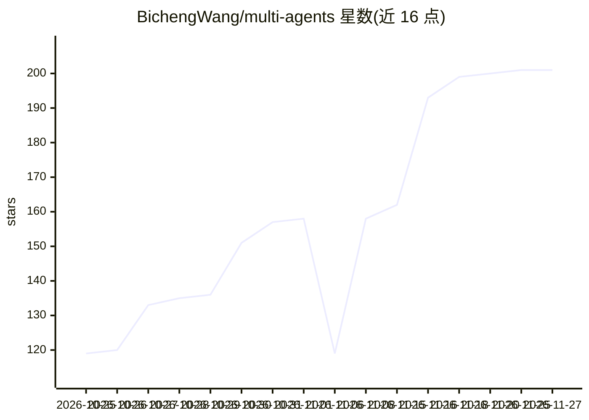

# BichengWang/multi-agents

⭐ 201 · Python · MIT · 推送 2026-11-25 · [GitHub](https://github.com/BichengWang/multi-agents) · [官网](https://bichengwang.github.io/multi-agents/) · 个人维护

**在隔离 git worktree 中运行编码 agent 团队并用基准对比单人成本**

Python CLI 工具，在用户的仓库任务上运行多个编码 agent：支持 solo、coder⇄reviewer 循环、多 worker 加 judge、planner 拆分子任务四种拓扑，worker 使用 Claude Code、Codex CLI 或经 OpenAI Agents SDK 接入任意模型的内置 agent，每个 worker 运行在独立 git worktree，产出补丁与逐次调用的 token/费用/时长记录。自带基准测试：以训练截止后的 GitHub issue 任务做团队 vs 单 agent 的配对比较，输出解决率、McNemar 检验与成本。目标用户是需要在真实仓库上评估多 agent 编码收益与开销的开发者。

## 筛选速览

| 维度 | 判定 | 备注 |
|---|---|---|
| AI 角色 | `ai-ecosystem` | LLM/agent 周边工具 |
| 许可风险 | `permissive` | MIT |
| 部署形态 | `library` | 以包/库形式分发 |
| 模型依赖 | locked-api |  |
| 硬件要求 | — | 无带数字的原话,不猜 |
| 安装摩擦 | `low` | 无编译、无系统依赖或容器化 |
| 成熟度 | — | 结构信号不足 |

## 能力要点

- 四种团队拓扑：solo、review 循环、best-of-N 加 judge、plan 拆分与重规划
- 每个 worker 运行在独立 git worktree，默认不动用户工作区
- 记录每次调用的 token、费用与时长，支持 --max-cost 预算停止
- 基准在训练截止后的新任务上做团队 vs 单 agent 的配对成本与胜率比较

## 适用场景

- 在我的仓库上让多个编码 agent 并行解 bug 并择优合并补丁
- 度量多 agent 团队相对单个 agent 在同类任务上的解决率与成本差异
- 从 GitHub issue 自动产出草稿 PR 并带测试检查

## 场景标签

`多智能体` `编码 Agent` `模型评测` · 领域:Agent 开发

## 证据(README 行号)

> L18: multi-agents architecture: entry points feed a team runner (solo, review, best, plan topologies; Claude Code, Codex
> L23: Run a team of coding agents on a task in your repository: a single agent, a coder ⇄ reviewer
> L155: The benchmark runs team specs against solo agents on GitHub issues opened after the models'

## 星数曲线

2026-10-25 119 → 2026-11-27 201（+82）

---
*卡片 v1 · prompt 1.4 · 生成 2026-11-25 · 置信度 high · 依据 README sha `2e547a7ddb5f` · [字段定义](../../DATASET.md)*
