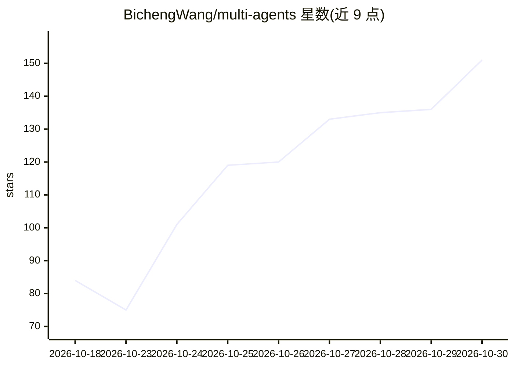

# BichengWang/multi-agents

⭐ 151 · Python · MIT · 推送 2026-10-29 · [GitHub](https://github.com/BichengWang/multi-agents) · [官网](https://bichengwang.github.io/multi-agents/) · 个人维护

**编排编码 agent 团队并测量其效果的运行器与基准**

在用户仓库中以多种拓扑运行编码 agent 团队的工具：单人、coder⇄reviewer 循环、并行竞争加裁判、planner 拆分子任务并行求解后合并补丁。worker 可以是 Claude Code、Codex CLI 或经 OpenAI Agents SDK 接入任意模型的内置 agent，每个 worker 运行在独立的 git worktree 中，默认沙箱权限隔离。每次运行记录 token、成本与耗时，产出单个补丁；支持 --check 测试验证、GitHub issue 转草稿 PR、--max-cost 预算。附带基于 SWE-bench-Live 的对比基准（Modal 或 Docker 后端），多项功能标注为冒烟测试或离线测试状态。

## 筛选速览

| 维度 | 判定 | 备注 |
|---|---|---|
| AI 角色 | `ai-ecosystem` | LLM/agent 周边工具 |
| 许可风险 | `permissive` | MIT |
| 部署形态 | `library` | 以包/库形式分发 |
| 模型依赖 | locked-api |  |
| 硬件要求 | — | 无带数字的原话,不猜 |
| 安装摩擦 | `low` | 无编译、无系统依赖或容器化 |
| 成熟度 | `idea` | |

## 能力要点

- solo/review/best/plan 四种团队拓扑，每个 worker 独立 git worktree
- 逐次记录 token、成本、秒数的明细账单，未定价运行不计入预算
- --issue 转任务、--pr 开草稿拉取请求、--check 测试驱动验证
- 基于训练截止后任务的 paired 基准（McNemar 检验、95% 置信区间）

## 适用场景

- 把一个任务交给 coder+reviewer 或多 agent 团队并拿回一个补丁
- 从 GitHub issue 直接生成草稿 PR
- 测量多 agent 团队相对单人 agent 的解决率与成本差异

## 场景标签

`多智能体` `编码 Agent` `模型评测` · 领域:Agent 开发

## 证据(README 行号)

> L5: Run a team of coding agents on a task in your repository: a single agent, a coder ⇄ reviewer
> L11: The benchmark then answers the question most agent orchestrators skip: **did the team beat a
> L34: Requirements: Python 3.10+, uv, git, and at least one logged-in

## 星数曲线

2026-10-18 84 → 2026-10-30 151（+67）

---
*卡片 v1 · prompt 1.4 · 生成 2026-10-24 · 置信度 high · 依据 README sha `f2d2b48a27cc` · [字段定义](../../DATASET.md)*
