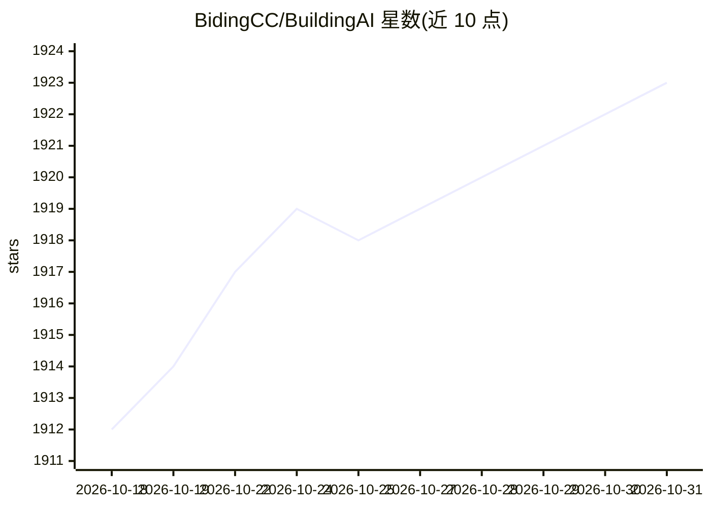

# BidingCC/BuildingAI

⭐ 1,923 · TypeScript · Apache-2.0 · 推送 2026-10-30 · [GitHub](https://github.com/BidingCC/BuildingAI) · [官网](https://www.buildingai.cc) · 组织维护 · 中文 README

**积木式可视化搭建企业 AI 应用与智能体的开源平台**

面向 AI 开发者、AI 创业者与企业的开源智能体平台：通过可视化配置界面（DIY）无代码搭建原生企业 AI 应用，内置智能体、MCP、RAG 管道、知识库、大模型聚合与上下文工程能力，并附带用户注册、会员订阅、算力计费等业务功能。技术栈为 NestJS/TypeORM/PostgreSQL/TypeScript/Vue.js 等，通过 Docker Compose 部署，启动后访问 localhost:4090/install 完成初始化向导；最低要求 2 核 CPU、4 GB 内存、5 GB 存储空间。采用 Apache 2.0 许可。

## 筛选速览

| 维度 | 判定 | 备注 |
|---|---|---|
| AI 角色 | `ai-ecosystem` | LLM/agent 周边工具 |
| 许可风险 | `permissive` | Apache-2.0 |
| 部署形态 | `self-host` | docker 或自建部署 |
| 模型依赖 | — | README 未给出锁定关系 |
| 硬件要求 | — | 无带数字的原话,不猜 |
| 安装摩擦 | `low` | 无编译、无系统依赖或容器化 |
| 成熟度 | — | 结构信号不足 |

## 能力要点

- 可视化无代码搭建智能体与 AI 应用
- 内置 RAG 知识库、向量检索与 MCP 工具调用（SSE/Streamable HTTP）
- 统一 API 规范接入主流大模型，支持多模态
- 内置会员管理、计费与支付功能

## 适用场景

- 零代码搭建企业智能体或 AI 客服系统
- 为组织部署带知识库与 RAG 的问答应用
- 运营带会员订阅与计费的 AI 应用平台

## 场景标签

`RAG` `Agent 框架` · 领域:Agent 开发

## 证据(README 行号)

> L17: BuildingAI is an enterprise-grade open-source intelligent agent platform designed for AI developers,
> L20: native capabilities such as intelligent agents, MCP, RAG pipelines, knowledge bases, large-model
> L55: - **AI Conversations**: Conversational AI and text generation powered by large language models, with

## 星数曲线

2026-10-18 1,912 → 2026-10-31 1,923（+11）

---
*卡片 v1 · prompt 1.4 · 生成 2026-10-21 · 置信度 high · 依据 README sha `248a0809185f` · [字段定义](../../DATASET.md)*
