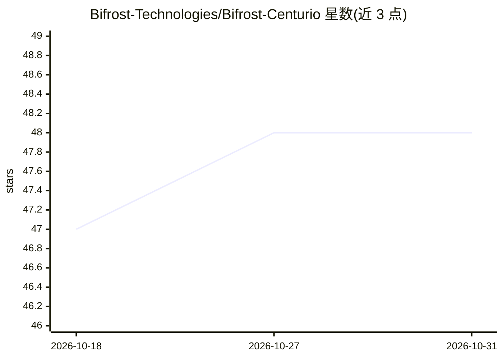

# Bifrost-Technologies/Bifrost-Centurio

⭐ 48 · C · Apache-2.0 · 推送 2026-07-29 · [GitHub](https://github.com/Bifrost-Technologies/Bifrost-Centurio) · [官网](https://bifrost.technology) · 组织维护

**基于 NASA cFS 的航天飞行导航任务软件栈，含 UE5 仿真回路**

在 NASA Core Flight System (cFS) 之上构建的任务软件栈：centurio_nav 应用发布位置/姿态/速度/油门遥测并接受制导控制命令；ue5_bridge 通过 JSON/UDP 将遥测镜像至 Unreal Engine 5 并接收闭环控制；配套 C# 地面站（主用，.NET 8/MAUI）与上游 Python 地面站（参考调试）。构建走 cFS/CMake 流程，需 Make/CMake/GCC，Windows 建议在 WSL 下构建。状态为活跃开发中，API 与 ID 可能变化。

## 筛选速览

| 维度 | 判定 | 备注 |
|---|---|---|
| AI 角色 | `ai-enhanced` | 去掉 AI 部分产品仍成立 |
| 许可风险 | `permissive` | Apache-2.0 |
| 部署形态 | `None` |  |
| 模型依赖 | — | README 未给出锁定关系 |
| 硬件要求 | — | 无带数字的原话,不猜 |
| 安装摩擦 | `high` | 编译与系统依赖俱全 |
| 成熟度 | `idea` | |

## 能力要点

- centurio_nav 导航控制应用：遥测（位置/姿态/速度/油门）与制导命令集
- ue5_bridge 以 JSON/UDP（15001/15002）连接 UE5 做在环仿真
- C# 地面站为主操作台，Python 地面站保留用于校验与调试

## 适用场景

- 航天任务软件的导航遥测与命令收发地面操作
- 通过 UE5 混合现实仿真做飞行软件闭环测试
- 作为 cFS 任务开发的工程骨架与参考实现

## 场景标签

 · 领域:航天/飞行软件

## 证据(README 行号)

> L3: Centurio is a mission software stack built on NASA's Core Flight System (cFS) that adds navigation, guidance, and si
> L9: - Real-time navigation and control app (`centurio_nav`) with mission-specific telemetry and commands

## 星数曲线

2026-10-18 47 → 2026-10-31 48（+1）

---
*卡片 v1 · prompt 1.4 · 生成 2026-10-25 · 置信度 low · 依据 README sha `9f26162a3396` · [字段定义](../../DATASET.md)*
