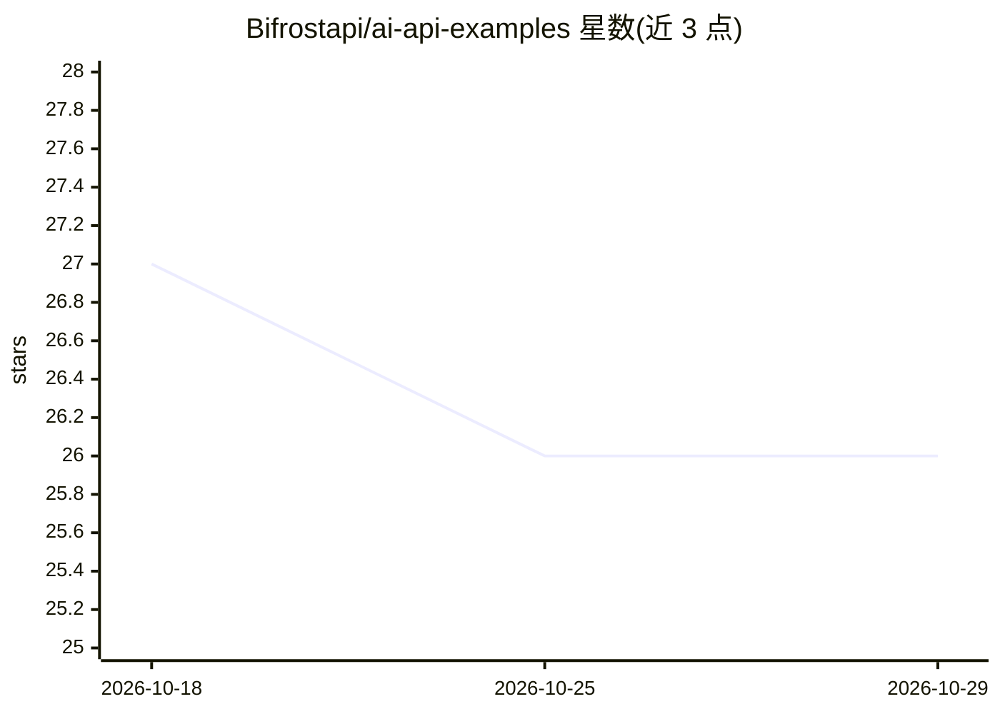

# Bifrostapi/ai-api-examples

⭐ 26 · NOASSERTION · 推送 2026-07-30 · [GitHub](https://github.com/Bifrostapi/ai-api-examples) · [官网](https://www.bifrostapi.net/login?ref=ZZWFCM) · 组织维护

**统一接入多家 LLM 的 OpenAI 兼容 API 网关**

面向开发者的 AI API 网关：通过单一端点与统一 API 密钥访问 GPT、Claude、Gemini、DeepSeek 及其他 OpenAI 兼容模型，对外提供 OpenAI 兼容 API，客户端可用官方 OpenAI SDK 直连。README 列出的功能包括简化密钥管理、统一 AI 基础设施、灵活模型切换与开发者友好的集成方式。当前 README 仅含简介、功能列表与快速上手示例，未展示自部署/安装本产品自身的完整流程，也未列出本地运行时支持。

## 筛选速览

| 维度 | 判定 | 备注 |
|---|---|---|
| AI 角色 | `ai-ecosystem` | LLM/agent 周边工具 |
| 许可风险 | `none` | NOASSERTION |
| 部署形态 | `library` | 以包/库形式分发 |
| 模型依赖 | locked-api |  |
| 硬件要求 | — | 无带数字的原话,不猜 |
| 安装摩擦 | `low` | 无编译、无系统依赖或容器化 |
| 成熟度 | — | 结构信号不足 |

## 能力要点

- 单一端点访问 GPT/Claude/Gemini/DeepSeek 等多家模型
- 对外提供 OpenAI 兼容 API，可直接使用 OpenAI SDK
- 统一 API 密钥管理与灵活模型切换

## 适用场景

- 应用需要同时调用多家 LLM 提供商时统一接入层
- 减少多套 API 格式与多把密钥的管理负担
- 在多个模型间快速切换而无需改动客户端代码

## 场景标签

`模型网关` · 领域:Agent 开发

## 证据(README 行号)

> L8: One API to access GPT, Claude, Gemini, DeepSeek and other LLMs.
> L19: Bifrostapi provides a unified API layer that makes AI infrastructure simpler.

## 星数曲线

2026-10-18 27 → 2026-10-29 26（-1）

---
*卡片 v1 · prompt 1.4 · 生成 2026-10-26 · 置信度 mid · 依据 README sha `efe03f5024c4` · [字段定义](../../DATASET.md)*
