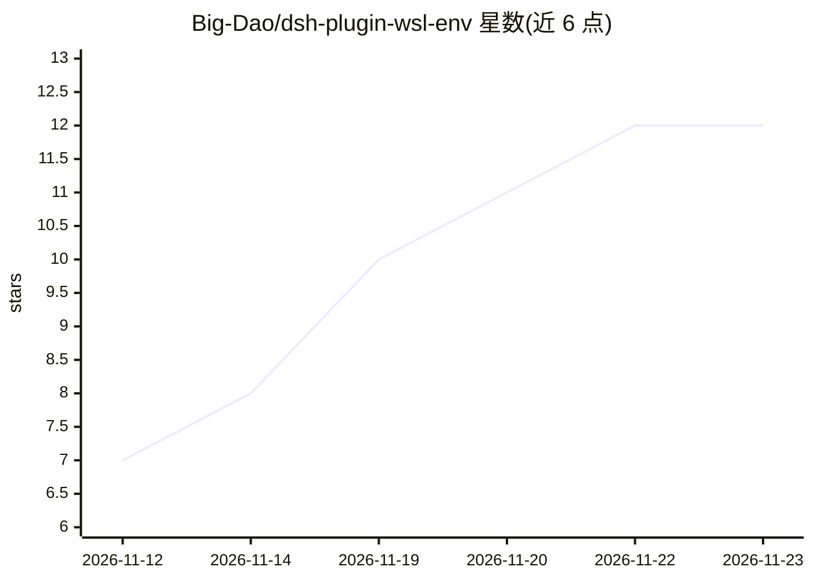

# Big-Dao/dsh-plugin-wsl-env

⭐ 12 · JavaScript · MIT · 推送 2026-11-22 · [GitHub](https://github.com/Big-Dao/dsh-plugin-wsl-env) · [官网](https://github.com/Big-Dao/dsh-plugin-wsl-env#readme) · 个人维护

**让 DeepSeek Harness 桌面会话在 WSL 发行版内执行的插件**

面向 Windows 上 DeepSeek Harness 桌面应用的插件：将 WSL 2 发行版作为执行环境，命令与文件操作经驻留 distro 的 agent（systemd user scope + bubblewrap 沙箱）运行，GUI 与模型调用留在 Windows，两者通过 stdio 管道连接；不安装服务、不开端口。提供 read-only/workspace-write/danger-full-access 三档权限，无 bubblewrap 时受限命令直接失败。安装经应用内 Plugins 页完成，开发需 Node ^22.19.0 || >=24.0.0 与 pnpm。

## 筛选速览

| 维度 | 判定 | 备注 |
|---|---|---|
| AI 角色 | `ai-ecosystem` | LLM/agent 周边工具 |
| 许可风险 | `permissive` | MIT |
| 部署形态 | `desktop` | 安装包/桌面程序 |
| 模型依赖 | locked-api |  |
| 硬件要求 | — | 无带数字的原话,不猜 |
| 安装摩擦 | `low` | 无编译、无系统依赖或容器化 |
| 成熟度 | — | 结构信号不足 |

## 能力要点

- 命令在 distro 登录 shell 运行，PATH/nvm/cargo/pyenv 等环境生效
- bubblewrap 沙箱三档权限，缺 bwrap 时命令不降级运行
- GUI 集成：目录选择器列出 distro，终端在 distro 内打开
- 提供 /wsl-doctor 诊断命令输出 ready/blocked 判定

## 适用场景

- 在 Windows 桌面应用中直接操作 WSL 内的项目文件与命令
- 需要 POSIX 环境（nvm/pyenv 等）且命令须沙箱化
- 一个会话同时覆盖 Windows 与 WSL 文件夹

## 场景标签

`编码 Agent` · 领域:编码与开发

## 证据(README 行号)

> L9: Turns a WSL 2 distro into the execution environment of a DeepSeek Harness desktop session: commands, files and the t
> L95: Commands and file operations go through a resident agent in the distro (systemd user scope + `bubblewrap` profile).

## 星数曲线

2026-11-12 7 → 2026-11-23 12（+5）

---
*卡片 v1 · prompt 1.4 · 生成 2026-11-20 · 置信度 high · 依据 README sha `9b9c1c34e3e1` · [字段定义](../../DATASET.md)*
