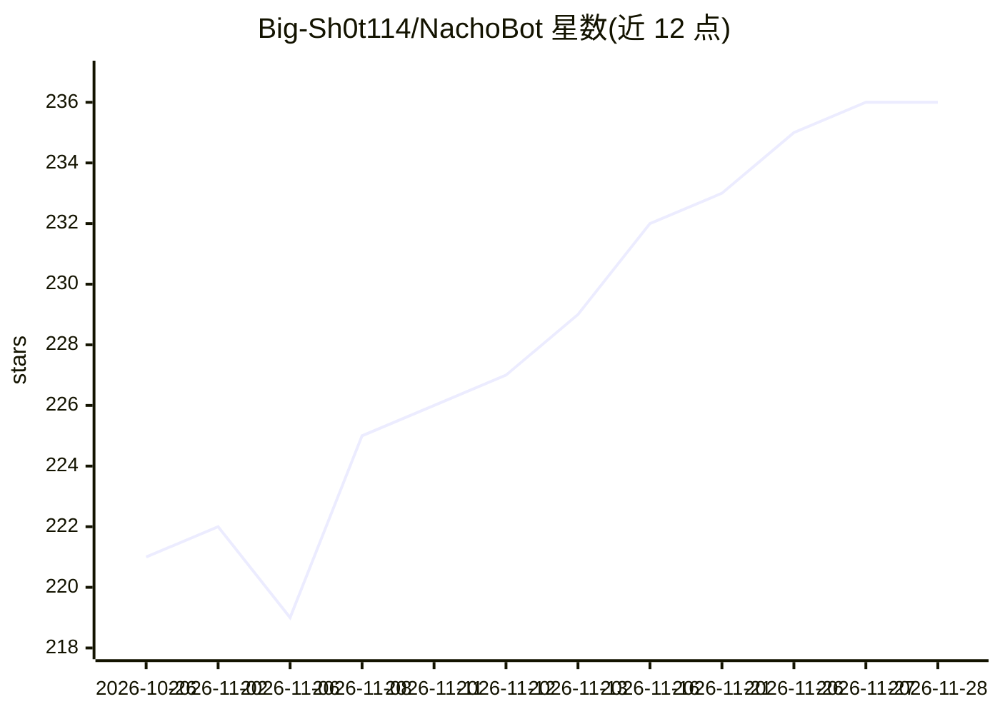

# Big-Sh0t114/NachoBot

⭐ 236 · Python · GPL-3.0 · 推送 2026-11-25 · [GitHub](https://github.com/Big-Sh0t114/NachoBot) · 个人维护 · 中文 README

**QQ/B站/Discord 多平台长记忆 AI 聊天陪伴机器人**

基于 MaiBot 核心修改的多平台机器人，采用"核心+多适配器"设计：核心引擎负责 LLM 接入、记忆管理与指令解析，适配器接入 Bilibili 直播、Discord 语音/文字与 QQ（NapCat/SnowLuma）。感知表现层托管 GPT-SoVITS/VoxCPM TTS、本地流式 ASR 与 Florence-2 VLM，并按语音情感分类选择语气。提供 WebUI 部署向导、多档启动脚本与桌宠、Live2D 等形态。推荐 Windows 10/11 与 Python 3.11/3.12，采用 GPLv3。

## 筛选速览

| 维度 | 判定 | 备注 |
|---|---|---|
| AI 角色 | `ai-native` | 本体是模型或模型工具 |
| 许可风险 | `viral` | GPL-3.0 |
| 部署形态 | `None` |  |
| 模型依赖 | — | README 未给出锁定关系 |
| 硬件要求 | — | 无带数字的原话,不猜 |
| 安装摩擦 | `low` | 无编译、无系统依赖或容器化 |
| 成熟度 | — | 结构信号不足 |

## 能力要点

- 核心+多适配器架构，覆盖 Bilibili 直播、Discord、QQ 三类平台
- 托管式 GPT-SoVITS/VoxCPM TTS、本地流式 ASR 与 Florence-2 VLM
- 语音情感分类自动选择生成语气；人物画像跨平台绑定与长期记忆迁移
- WebUI 部署向导、进程与配置管理、数据库浏览及网页聊天

## 适用场景

- 在 QQ 群里运行一个有长期记忆的 AI 聊天角色
- 让 AI 以虚拟主播形态在 Bilibili 直播间互动
- 在 Discord 语音频道里进行实时语音陪聊
- 在桌面运行 Live2D 桌宠形态的 AI 伙伴

## 场景标签

`聊天机器人` `语音 Agent` · 领域:对话与助手

## 证据(README 行号)

> L9:  NachoBot 赋予了 AI 大语言模型一个完整的虚拟灵魂
> L11: 采用“核心+多适配器”的设计理念，它可以化身为 Bilibili 直播间的虚拟主播、Discord 语音频道的陪玩伙伴，或是活跃在 QQ 群里的赛博老婆
> L67: 负责大语言模型接入、记忆管理、指令解析与全局配置

## 星数曲线

2026-10-26 221 → 2026-11-28 236（+15）

---
*卡片 v1 · prompt 1.4 · 生成 2026-11-25 · 置信度 high · 依据 README sha `6a8c2bfd30ee` · [字段定义](../../DATASET.md)*
