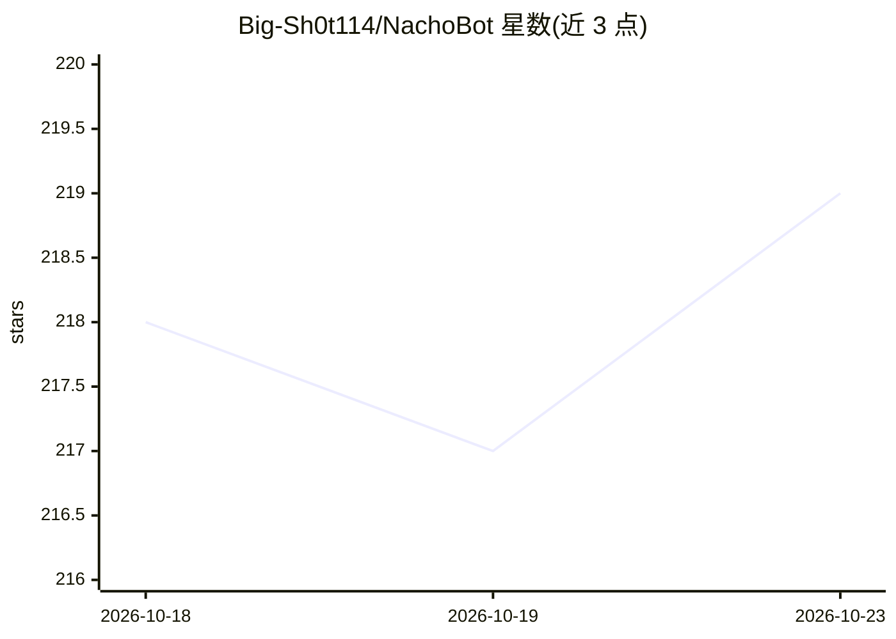

# Big-Sh0t114/NachoBot

⭐ 219 · Python · GPL-3.0 · 推送 2026-10-20 · [GitHub](https://github.com/Big-Sh0t114/NachoBot) · 个人维护 · 中文 README

**多平台 AI 虚拟生命：在 QQ/B站/Discord 做虚拟主播与陪聊**

基于 MaiBot 核心修改的聊天机器人，采用“核心+多适配器”架构，接入大语言模型提供长时记忆与多模态交互：GPT-SoVITS/VoxCPM 托管 TTS、本地流式 ASR、Florence-2 视觉理解、语音情感分类与语气选择。平台侧支持 Bilibili 直播（含 Live2D 驱动）、Discord 文字与原生语音、QQ（NapCat/SnowLuma 链路）；提供 WebUI 部署向导与多档启动脚本，推荐 Windows 10/11、Python 3.11/3.12。采用 GPLv3 许可。

## 筛选速览

| 维度 | 判定 | 备注 |
|---|---|---|
| AI 角色 | `ai-native` | 本体是模型或模型工具 |
| 许可风险 | `viral` | GPL-3.0 |
| 部署形态 | `None` |  |
| 模型依赖 | — | README 未给出锁定关系 |
| 硬件要求 | — | 无带数字的原话,不猜 |
| 安装摩擦 | `low` | 无编译、无系统依赖或容器化 |
| 成熟度 | — | 结构信号不足 |

## 能力要点

- 跨平台人物画像绑定与长期记忆迁移
- Discord 原生语音通话与通用语音适配器
- Bilibili 直播接入 Live2D 驱动模型
- WebUI 一键部署、进程配置管理与网页聊天

## 适用场景

- 在 QQ 群里运行带长期记忆的 AI 陪聊机器人
- B 站直播间部署可语音互动的虚拟主播
- Discord 语音频道里做陪玩伙伴

## 场景标签

`聊天机器人` `语音 Agent` · 领域:对话与助手

## 证据(README 行号)

> L3:  一个具备长时记忆与多模态感知能力的多平台 AI 虚拟生命
> L11: 采用“核心+多适配器”的设计理念，它可以化身为 Bilibili 直播间的虚拟主播、Discord 语音频道的陪玩伙伴，或是活跃在 QQ 群里的赛博老婆

## 星数曲线

2026-10-18 218 → 2026-10-23 219（+1）

---
*卡片 v1 · prompt 1.4 · 生成 2026-10-22 · 置信度 high · 依据 README sha `25866e1b8737` · [字段定义](../../DATASET.md)*
