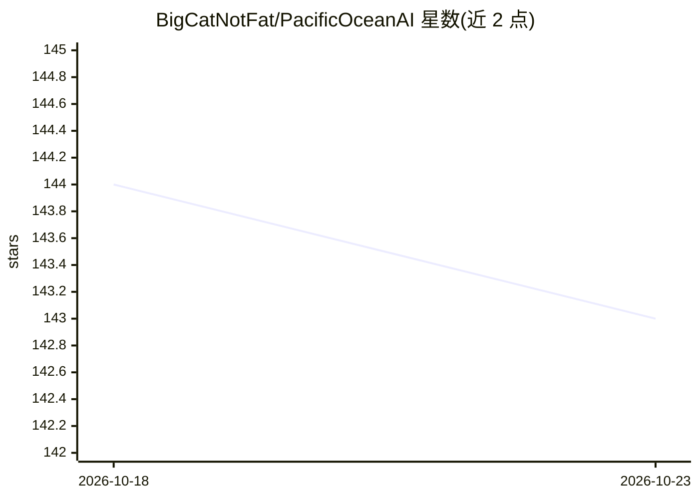

# BigCatNotFat/PacificOceanAI

⭐ 143 · TypeScript · AGPL-3.0 · 推送 2026-06-27 · [GitHub](https://github.com/BigCatNotFat/PacificOceanAI) · 个人维护 · 中文 README

**Overleaf LaTeX 编辑器的 AI 写作助手浏览器扩展**

面向在 Overleaf 中进行学术写作的用户的 Chrome/Edge 扩展：提供多模型 AI 写作辅助（改写、语法修正、翻译、扩缩写、自定义操作）、基于文档上下文的对话、函数调用直接操作文档，以及经 CrossRef 搜索并引用学术论文。兼容 OpenAI、Anthropic Claude、Google Gemini、OpenAI 兼容 API，并支持以 ChatGPT OAuth 订阅代替 API key。所有数据本地存储，无自有服务器。安装方式为从源码构建并以开发者模式加载，商店分发数据未公开。

## 筛选速览

| 维度 | 判定 | 备注 |
|---|---|---|
| AI 角色 | `ai-native` | 本体是模型或模型工具 |
| 许可风险 | `viral` | AGPL-3.0 |
| 部署形态 | `library` | 以包/库形式分发 |
| 模型依赖 | locked-api |  |
| 硬件要求 | — | 无带数字的原话,不猜 |
| 安装摩擦 | `low` | 无编译、无系统依赖或容器化 |
| 成熟度 | — | 结构信号不足 |

## 能力要点

- 多模型支持：OpenAI、Claude、Gemini、OpenAI 兼容 API 与 ChatGPT OAuth
- AI 可通过函数调用工具直接与 LaTeX 文档交互
- CrossRef 学术文献搜索与引用
- 数据全部本地存储，无自有服务器与分析服务

## 适用场景

- 在 Overleaf 中改写、润色或翻译 LaTeX 文本
- 围绕当前文档与 AI 对话并审阅后应用修改
- 搜索学术论文并插入引用

## 场景标签

`AI 写作` `科研工具` · 领域:内容生成

## 证据(README 行号)

> L5: **AI-Powered Writing Assistant for Overleaf LaTeX Editor**
> L22:  - Improve writing quality and clarity

## 星数曲线

2026-10-18 144 → 2026-10-23 143（-1）

---
*卡片 v1 · prompt 1.4 · 生成 2026-10-22 · 置信度 high · 依据 README sha `bbd41a1d099b` · [字段定义](../../DATASET.md)*
