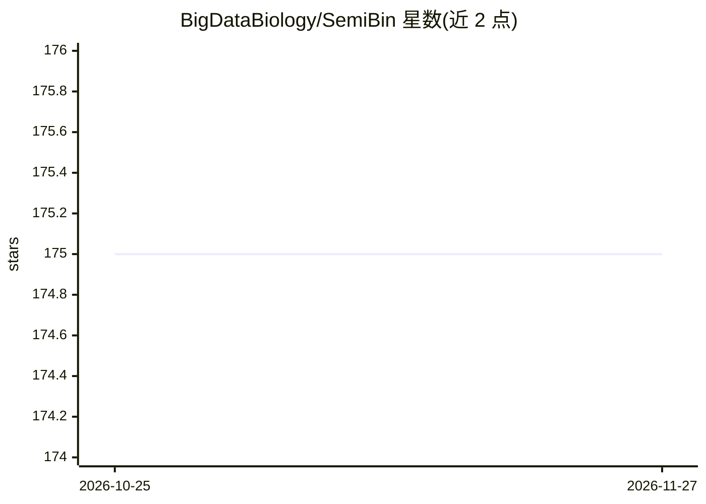

# BigDataBiology/SemiBin

⭐ 175 · Python · MIT · 推送 2026-11-15 · [GitHub](https://github.com/BigDataBiology/SemiBin) · [官网](https://semibin.rtfd.io/) · 组织维护

**给微生物组研究者：用深度学习做宏基因组分箱的工具**

SemiBin 是一个命令行宏基因组分箱（binning）工具，使用孪生神经网络与自监督对比学习，支持短读长与长读长数据。输入为 contigs（FASTA）与 BAM 比对文件，输出分箱结果、训练的深度学习模型及特征文件。提供单样本、共组装与多样本三种模式，内置 12 种环境预设模型（human_gut/ocean/soil 等），也可自行训练新模型；支持 GPU（CUDA）与 CPU-only 运行，通过 conda/bioconda、pixi 或 pip 源码安装，源码安装需 Bedtools 与 Hmmer 依赖。

## 筛选速览

| 维度 | 判定 | 备注 |
|---|---|---|
| AI 角色 | `ai-native` | 本体是模型或模型工具 |
| 许可风险 | `permissive` | MIT |
| 部署形态 | `library` | 以包/库形式分发 |
| 模型依赖 | — | README 未给出锁定关系 |
| 硬件要求 | `cpu-ok` | |
| 安装摩擦 | `medium` | 含编译或系统依赖之一 |
| 成熟度 | — | 结构信号不足 |

## 能力要点

- 自监督对比学习的宏基因组分箱命令行工具
- 支持短读长与长读长（长读使用 ensemble DBSCAN 算法）
- 12 种内置环境预训练模型可选，也可训练并复用自定义模型
- 支持 strobealign-aemb 丰度信息作为输入

## 适用场景

- 对人类肠道等环境样本做单样本宏基因组分箱
- 多样本宏基因组数据的联合分箱
- 对 Nanopore/PacBio 长读长组装结果做分箱

## 场景标签

 · 领域:生物信息学/宏基因组分析

## 证据(README 行号)

> L9:  SemiBin is a command tool for metagenomic binning with deep learning, handles both short and long reads.
> L24: A tutorial of running SemiBin from scratch can be found here SemiBin tutorial.

## 星数曲线

2026-10-25 175 → 2026-11-27 175（+0）

---
*卡片 v1 · prompt 1.4 · 生成 2026-11-26 · 置信度 high · 依据 README sha `11d82867e855` · [字段定义](../../DATASET.md)*
