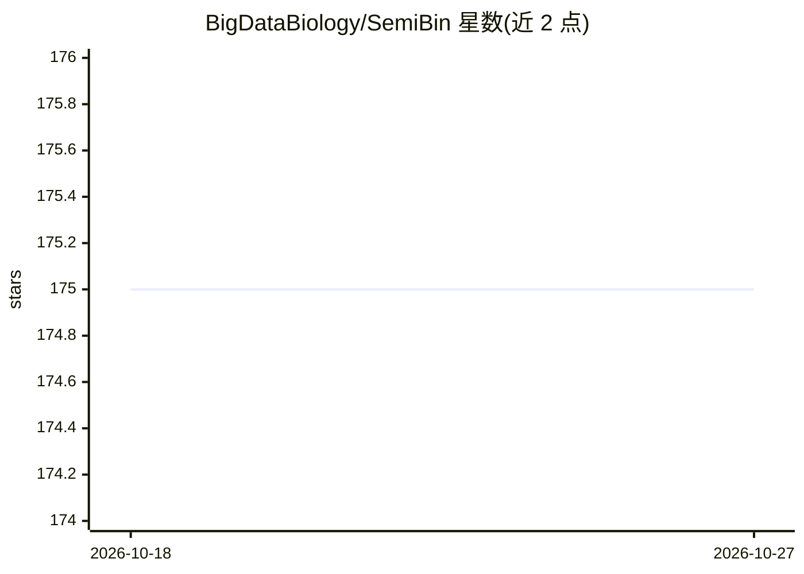

# BigDataBiology/SemiBin

⭐ 175 · Python · MIT · 推送 2026-10-13 · [GitHub](https://github.com/BigDataBiology/SemiBin) · [官网](https://semibin.rtfd.io/) · 组织维护

**宏基因组分箱工具：用自监督深度学习从contigs产出MAGs**

面向宏基因组学研究的命令行工具，基于孪生神经网络与自监督对比学习，将组装得到的contigs聚类为宏基因组组装基因组（MAGs），支持短读长与长读长数据（长读长使用集成DBSCAN算法）。输入为contigs文件与BAM比对文件，或strobealign-aemb的丰度信息；支持单样本、共组装与多样本模式，内置12种环境预训练模型（human_gut、ocean等）可直接使用，也可为样本训练新模型（耗时且占磁盘）。

## 筛选速览

| 维度 | 判定 | 备注 |
|---|---|---|
| AI 角色 | `ai-native` | 本体是模型或模型工具 |
| 许可风险 | `permissive` | MIT |
| 部署形态 | `library` | 以包/库形式分发 |
| 模型依赖 | — | README 未给出锁定关系 |
| 硬件要求 | `cpu-ok` | |
| 安装摩擦 | `medium` | 含编译或系统依赖之一 |
| 成熟度 | — | 结构信号不足 |

## 能力要点

- 孪生神经网络+自监督对比学习做metagenomic binning
- 同时支持短读长与长读长（集成DBSCAN算法）
- 内置12种环境预训练模型，可免训练直接分箱
- 支持单样本/共组装/多样本三种模式，兼容strobealign-aemb丰度输入

## 适用场景

- 从宏基因组组装结果中恢复微生物基因组（MAGs）
- 处理人体肠道、海洋、土壤等环境样本的分箱
- 长读长测序数据的宏基因组分箱

## 场景标签

 · 领域:生物信息学/宏基因组学

## 证据(README 行号)

> L9:  SemiBin is a command tool for metagenomic binning with deep learning, handles both short and long reads.
> L15: > Pan, S.; Zhu, C.; Zhao, XM.; Coelho, LP. A deep siamese neural network improves metagenome-assembled genomes in m
> L20: > Pan, S.; Zhao, XM; Coelho, LP. SemiBin2: self-supervised contrastive learning leads to better MAGs for short- and

## 星数曲线

2026-10-18 175 → 2026-10-27 175（+0）

---
*卡片 v1 · prompt 1.4 · 生成 2026-10-22 · 置信度 high · 依据 README sha `2126ac3ab2d0` · [字段定义](../../DATASET.md)*
