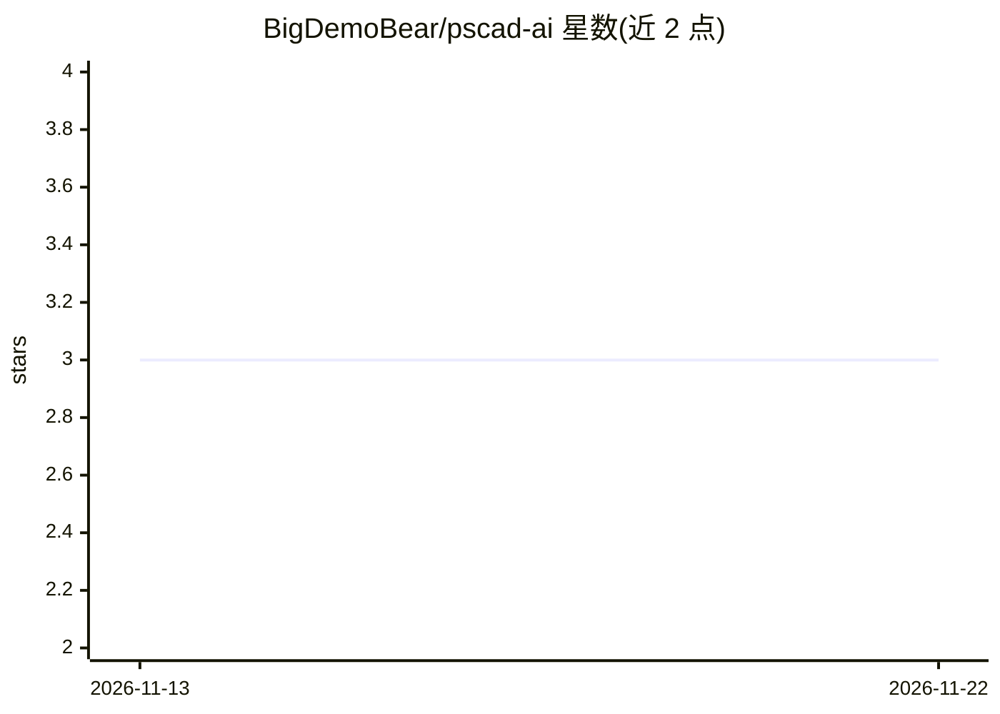

# BigDemoBear/pscad-ai

⭐ 3 · Python · MIT · 推送 2026-10-29 · [GitHub](https://github.com/BigDemoBear/pscad-ai) · 个人维护 · 中文 README

**让 AI 在 PSCAD 4.6.2 中建模、运行仿真并读取结果**

为 PSCAD 4.6.2 提供的 AI 工作流工具：通过官方 mhrc.automation 驱动 PSCAD，提供工程增量编辑（以 .pscx 为依据、按组件引用定位）、后台仿真会话管理（任务编号、暂停/继续/停止）、数值查询（.inf/.out/CSV 选通道与统计）和本地 Help 检索四类工具。支持 MCP、CLI、Python 接口和 skill 四种接入方式，保存原生工程可继续在 PSCAD 中编辑。要求 Windows、PSCAD x64 授权、GFortran 与 Python 3.11+，版本 0.1.0，MIT 许可。

## 筛选速览

| 维度 | 判定 | 备注 |
|---|---|---|
| AI 角色 | `ai-ecosystem` | LLM/agent 周边工具 |
| 许可风险 | `permissive` | MIT |
| 部署形态 | `desktop` | 安装包/桌面程序 |
| 模型依赖 | — | README 未给出锁定关系 |
| 硬件要求 | — | 无带数字的原话,不猜 |
| 安装摩擦 | `low` | 无编译、无系统依赖或容器化 |
| 成熟度 | — | 结构信号不足 |

## 能力要点

- 基于官方 mhrc.automation 驱动 PSCAD，输出可继续编辑的原生 .pscx 工程
- 增量编辑保留无关结构，编辑前保存副本并留有修改记录
- 后台会话与任务状态查询，批量工况支持暂停/继续/停止
- 本地官方 Help 与自动化 API 文档检索

## 适用场景

- 让 AI 在已有 PSCAD 工程上调整参数并重新仿真
- 半成品拓扑的分阶段建模与接线补充
- 批量工况仿真后按通道和时间窗查询数值
- 建模时检索本地 Help 确认元件参数与端口

## 场景标签

`工作流自动化` · 领域:效率与自动化

## 证据(README 行号)

> L9: 已有模型、部分完成的工程，或一个空白项目，都可以成为起点。PSCAD AI 为 AI 提供工程编辑、仿真执行、数据读取和资料查询工具，让它能够接着你的工程往下做，并交付可继续编辑的原生模型与实际仿真数值。
> L61: ## 接入 AI
> L63: 选择具备本地命令执行能力或支持 stdio MCP 的 AI 客户端，将仿真需求、已有工程和关注的指标提供给它。

## 星数曲线

2026-11-13 3 → 2026-11-22 3（+0）

---
*卡片 v1 · prompt 1.4 · 生成 2026-11-22 · 置信度 high · 依据 README sha `bfb551e2482d` · [字段定义](../../DATASET.md)*
