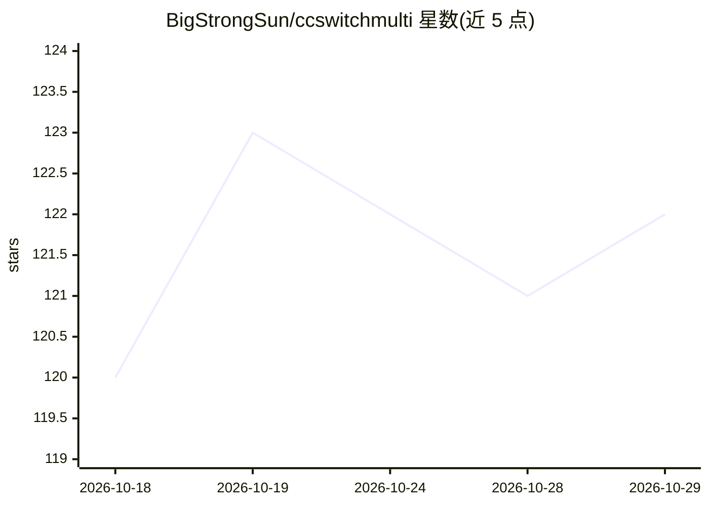

# BigStrongSun/ccswitchmulti

⭐ 122 · Rust · MIT · 推送 2026-10-25 · [GitHub](https://github.com/BigStrongSun/ccswitchmulti) · 个人维护 · 中文 README

**桌面工具：为 Codex 等八类 Agent 工具做多模型 Provider 管理与本地路由**

基于 Tauri 的跨平台桌面应用，是 CC Switch 的 Codex 多模型分支。提供 Provider 数据库、本地代理、MCP/Skills 同步、会话管理与云同步；核心的 Codex MultiRouter 可把官方 OpenAI/Codex、Qwen、DeepSeek、本地 vLLM 等多个上游合并到同一个 Codex Provider 后，按模型前缀分流请求，支持协议转换（Responses/Chat Completions/Anthropic）。面向持有 ChatGPT 订阅并希望把子任务路由到低成本模型的用户。使用时需保持本应用运行，Codex 请求经本地 takeover 代理转发；macOS 包未签名公证。

## 筛选速览

| 维度 | 判定 | 备注 |
|---|---|---|
| AI 角色 | `ai-ecosystem` | LLM/agent 周边工具 |
| 许可风险 | `permissive` | MIT |
| 部署形态 | `desktop` | 安装包/桌面程序 |
| 模型依赖 | local-ok | 支持本地模型 |
| 硬件要求 | — | 无带数字的原话,不猜 |
| 安装摩擦 | `low` | 无编译、无系统依赖或容器化 |
| 成熟度 | — | 结构信号不足 |

## 能力要点

- Codex MultiRouter：单一 Codex 入口按模型前缀路由到多个上游（官方 GPT/Qwen/DeepSeek/本地 vLLM）
- Rust 本地代理支持 Responses、Chat Completions、Anthropic 协议转换
- 模型目录由统一 compiler 从 Provider 与 Route policy 投影生成，带 dependency fingerprint
- 外部 OpenAI-compatible API sidecar 供第三方客户端使用；提供按模型的请求/token/成本统计

## 适用场景

- 我有 ChatGPT 订阅，想让主 Agent 用 GPT、子任务切到 DeepSeek 或本地模型省额度
- 在 Codex Desktop 的同一个模型菜单里同时看到官方与第三方模型
- 统一管理多个 Agent 工具的 Provider 配置并观测各模型成本

## 场景标签

`模型网关` · 领域:Agent 开发

## 证据(README 行号)

> L18: CCSwitchMulti 是面向 Codex 多模型工作流维护的桌面工具。它提供 Provider 数据库、本地代理、MCP/Skills 同步、会话管理、云同步和 Tauri 跨平台结构，同时加入 Codex MultiRou
> L42: `OpenAI Multi-Model Router` 会作为一个 Codex Provider 出现在列表中。它不是普通单一上游，而是一个本地路由入口：Codex 只连到 CCSwitchMulti，本地代理再按模型把请求分发到

## 星数曲线

2026-10-18 120 → 2026-10-29 122（+2）

---
*卡片 v1 · prompt 1.4 · 生成 2026-10-23 · 置信度 high · 依据 README sha `ab97a8883bfc` · [字段定义](../../DATASET.md)*
