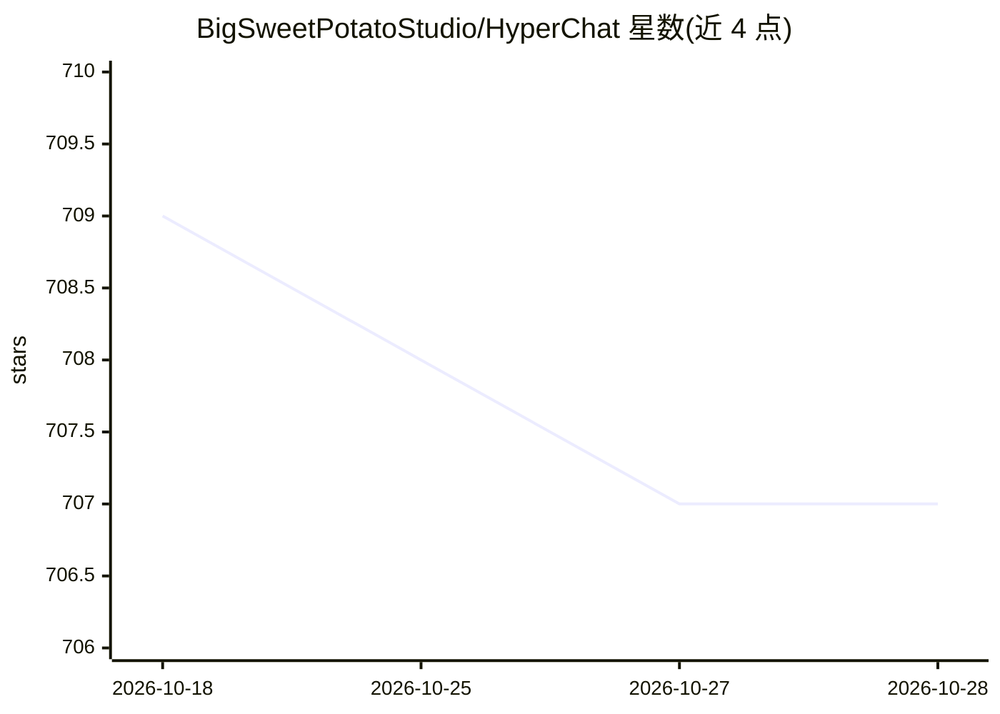

# BigSweetPotatoStudio/HyperChat

⭐ 708 · TypeScript · NOASSERTION · 推送 2026-08-26 · [GitHub](https://github.com/BigSweetPotatoStudio/HyperChat) · 组织维护 · 中文 README

**本地 AI Agent 平台/聊天客户端，配置文件驱动，MCP 工具集成**

面向终端用户与开发者的本地 AI Agent 平台，采用双层架构：Web 多工作区模式支持多标签页管理、工作区级 MCP 服务池、SSE 流式推送与图形化配置；CLI 模式以 Agent 为中心，支持快速启动单 Agent 与命令行自动化。AI 能力通过 .hyperchat/ 目录以配置文件形式定义，可用 Git 版本控制与一键迁移。通过环境变量接入各类 LLM API（可配 openai 等提供方），支持 Agent 自定义 Markdown 命令模板与项目记忆。以 npm 安装 CLI，或从源码构建，另含 Electron 与 Web 包。

## 筛选速览

| 维度 | 判定 | 备注 |
|---|---|---|
| AI 角色 | `ai-native` | 本体是模型或模型工具 |
| 许可风险 | `none` | NOASSERTION |
| 部署形态 | `library` | 以包/库形式分发 |
| 模型依赖 | — | README 未给出锁定关系 |
| 硬件要求 | — | 无带数字的原话,不猜 |
| 安装摩擦 | `low` | 无编译、无系统依赖或容器化 |
| 成熟度 | — | 结构信号不足 |

## 能力要点

- Web 多工作区 + CLI Agent 双模式架构
- AI 配置以 .hyperchat/ 目录文件化，支持 Git 管理与项目迁移
- MCP 协议工具集成，可操作本地文件系统
- Agent 自定义 Markdown 命令模板与专属记忆

## 适用场景

- 为项目配置专属 AI 助手并纳入 Git 版本管理
- 通过 CLI 快速启动 Agent 处理对话与自动化任务
- 团队共享工作区级 MCP 服务池与 Agent 配置

## 场景标签

`AI 助手` `聊天机器人` · 领域:对话与助手

## 证据(README 行号)

> L5: > 🌟 **本地 AI Agent 平台** - 首创 AI as Code 理念，让每个项目都有专属的 AI 大脑
> L13: - 🔧 **深度工具集成**：MCP 协议支持，可直接操作本地文件系统

## 星数曲线

2026-10-18 709 → 2026-10-28 707（-2）

---
*卡片 v1 · prompt 1.4 · 生成 2026-10-22 · 置信度 high · 依据 README sha `b433a94d1c50` · [字段定义](../../DATASET.md)*
