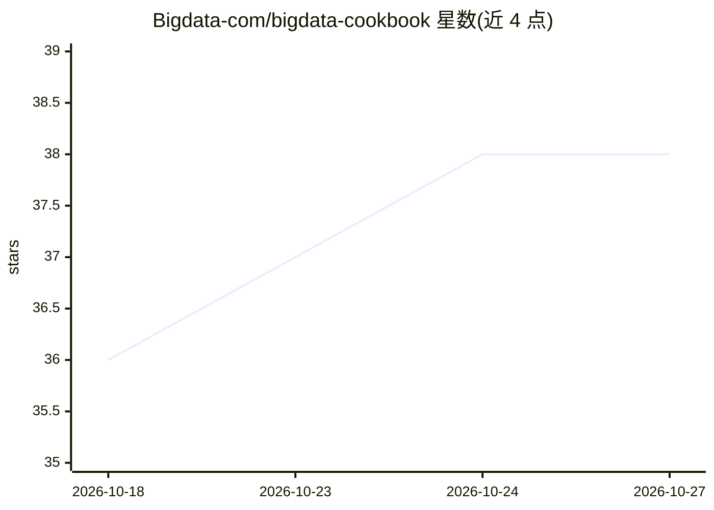

# Bigdata-com/bigdata-cookbook

⭐ 38 · HTML · MIT · 推送 2026-10-22 · [GitHub](https://github.com/Bigdata-com/bigdata-cookbook) · [官网](http://www.bigdata.com) · 组织维护

**基于 Bigdata API 的金融文本分析即用笔记本合集**

Bigdata.com 维护的金融研究 notebook 库：将新闻、财报、电话会等非结构化金融文本转化为主题评分、风险筛查、叙事挖掘、信用监控与自动化报告。每个 cookbook 自包含，指向自己的股票池或主题即可产出分数、仪表盘与可分享简报，覆盖股票、主权债、加密货币、宏观等。依赖 Bigdata API 与 Bigdata-Research-Tools 库，支持 Docker 或本地安装，部分带 MCP/CLI 入口，面向投研团队与组合经理。

## 筛选速览

| 维度 | 判定 | 备注 |
|---|---|---|
| AI 角色 | `ai-native` | 本体是模型或模型工具 |
| 许可风险 | `permissive` | MIT |
| 部署形态 | `self-host` | docker 或自建部署 |
| 模型依赖 | — | README 未给出锁定关系 |
| 硬件要求 | — | 无带数字的原话,不猜 |
| 安装摩擦 | `low` | 无编译、无系统依赖或容器化 |
| 成熟度 | — | 结构信号不足 |

## 能力要点

- 20+ 个自包含即用 notebook，覆盖主题筛选、信用、叙事挖掘与每日简报
- Thematic Screener CLI 可在终端或经 MCP 使用
- 批量组合简报生成（数百至上千公司，CSV 输入）
- 多数 notebook 附静态 HTML 预览，无需运行即可浏览

## 适用场景

- 按主题对公司池做暴露度评分与排序
- 监控信用评级事件与主权债风险
- 每天为组合生成带来源的多维度晨报
- 从电话会中做管理层语气打分与趋势跟踪

## 场景标签

`RAG` `金融量化` `教程课程` · 领域:知识与检索

## 证据(README 行号)

> L1: # Bigdata Cookbook
> L3: Turn unstructured financial news, filings, and transcripts into investment-ready intelligence. This repository is a 
> L104: - Grounded Q&A over the tearsheet via traditional RAG (OpenAI chat completions)

## 星数曲线

2026-10-18 36 → 2026-10-27 38（+2）

---
*卡片 v1 · prompt 1.4 · 生成 2026-10-25 · 置信度 high · 依据 README sha `849f46b2d92e` · [字段定义](../../DATASET.md)*
