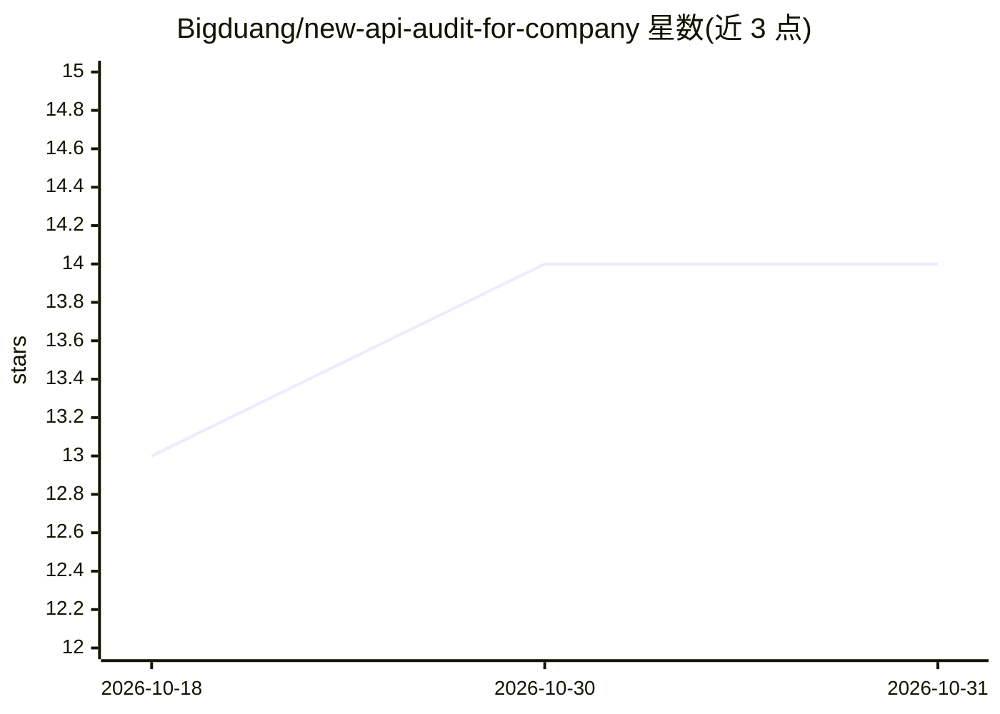

# Bigduang/new-api-audit-for-company

⭐ 14 · Python · MIT · 推送 2026-10-29 · [GitHub](https://github.com/Bigduang/new-api-audit-for-company) · 个人维护 · 中文 README

**New-API 的 token 用量与工作用途事后审计服务，供企业内部中转站使用**

独立运行的 FastAPI 审计服务：接收 New-API hook 上报的请求事件与用量事件，按 request_id 合并后存入 SQLite（prompt 以 AES-GCM 加密），每天定时用规则与 OpenAI 兼容 LLM 判断请求是否为工作用途（开发/调试/文档/代码审查等），生成 HTML 日报并通过企业微信 textcard 推送摘要。附带 React 管理端，支持审计用户启停、请求历史筛选、完整 Prompt 按需解密与人工复核。面向 VPS 上运行小型公司内部 LLM 中转站的运维者，Docker Compose 部署，数据保留 30 天，分类非实时执行。

## 筛选速览

| 维度 | 判定 | 备注 |
|---|---|---|
| AI 角色 | `ai-ecosystem` | LLM/agent 周边工具 |
| 许可风险 | `permissive` | MIT |
| 部署形态 | `self-host` | docker 或自建部署 |
| 模型依赖 | — | README 未给出锁定关系 |
| 硬件要求 | — | 无带数字的原话,不猜 |
| 安装摩擦 | `low` | 无编译、无系统依赖或容器化 |
| 成熟度 | — | 结构信号不足 |

## 能力要点

- request/usage 双事件按 request_id upsert 关联，HMAC-SHA256 验签防重放
- 完整 Prompt AES-GCM 加密存储，管理端登录后按需解密查看
- 规则+LLM 分类判定工作/非工作用途，支持人工复核（confirmed/false_positive 等状态）
- 生成移动端友好 HTML 日报并通过企业微信 textcard 推送

## 适用场景

- 统计公司内部中转站每个用户/token 的请求数与 token/quota 消耗
- 复核疑似非工作用途的 LLM 请求并保留 prompt 证据
- 每天早上自动收到前一天用量的企业微信日报推送

## 场景标签

`LLM 可观测性` · 领域:评测与运维

## 证据(README 行号)

> L9: `token-audit` 是一个独立运行的审计服务，用来接收 Bigduang/new-api-audit 上报的请求事件和用量事件，按 `request_id` 合并 prompt、用户、token、模型、tokens、quot
> L14: - 判断请求是否用于工作，尤其是开发、调试、架构、部署、文档、代码审查、数据分析等场景。

## 星数曲线

2026-10-18 13 → 2026-10-31 14（+1）

---
*卡片 v1 · prompt 1.4 · 生成 2026-10-31 · 置信度 mid · 依据 README sha `55f084bf592a` · [字段定义](../../DATASET.md)*
