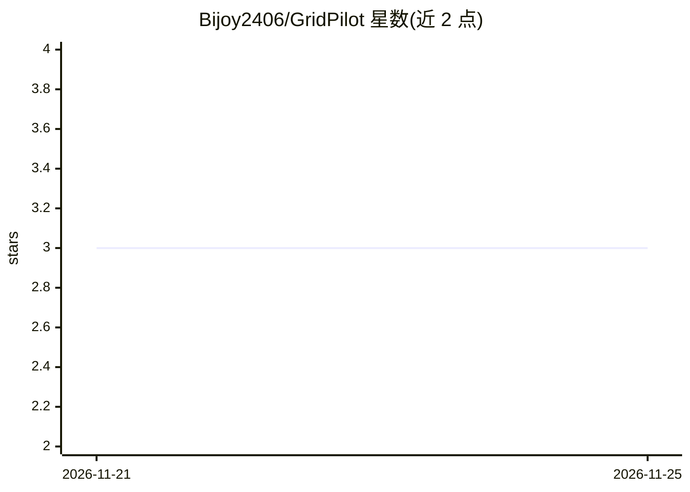

# Bijoy2406/GridPilot

⭐ 3 · Python · 推送 2026-11-20 · [GitHub](https://github.com/Bijoy2406/GridPilot) · [官网](https://gridpilot.xven.app) · 组织维护

**多智能体工厂能源调度原型：优化器决策，LLM 解释**

面向商业园区的 24 小时能源调度多智能体系统原型：七个 agent 分工覆盖光伏/负荷预测（P10/P50/P90 区间）、电价与 CO2 因子信号、资产约束、MILP 优化（成本与 CO2 加权目标）、风险重规划、LLM 解释与基线回测。LLM 仅基于工具输出的数字回答 why 问题，不做决策。基于模拟数据，MVP 尚在开发中（Phase 0），提供 FastAPI 后端与 Vite+React 前端仪表盘。

## 筛选速览

| 维度 | 判定 | 备注 |
|---|---|---|
| AI 角色 | `ai-native` | 本体是模型或模型工具 |
| 许可风险 | `none` | — |
| 部署形态 | `library` | 以包/库形式分发 |
| 模型依赖 | — | README 未给出锁定关系 |
| 硬件要求 | — | 无带数字的原话,不猜 |
| 安装摩擦 | `low` | 无编译、无系统依赖或容器化 |
| 成熟度 | `idea` | |

## 能力要点

- 七个 agent 的编排架构：预测、信号、资产、MILP 规划、风险、解释、评估
- MILP 优化器最小化 w×cost+(1−w)×CO2，决策全部由确定性优化器做出
- LLM 解释器只使用工具输出数字回答问题，数字可验证
- FastAPI 后端带示例数据回退，前端为 Vite+React+TypeScript 仪表盘

## 适用场景

- 为含光伏、储能、EV 充电与柴油发电的园区生成 24 小时调度计划
- 在成本与碳排放之间加权权衡调度目标
- 向非技术干系人解释调度决策的依据

## 场景标签

`多智能体` · 领域:Agent 开发

## 证据(README 行号)

> L4: diesel generator for the next 24 hours, to cut electricity cost and CO2. A deterministic optimiser makes every
> L36: |Planner|MILP: minimise w × cost + (1 − w) × CO2|#17|
> L38: |Explainer|LLM answers "why" questions from tool outputs only|#19|

## 星数曲线

2026-11-21 3 → 2026-11-25 3（+0）

---
*卡片 v1 · prompt 1.4 · 生成 2026-11-22 · 置信度 high · 依据 README sha `5d14c4d3a7d1` · [字段定义](../../DATASET.md)*
