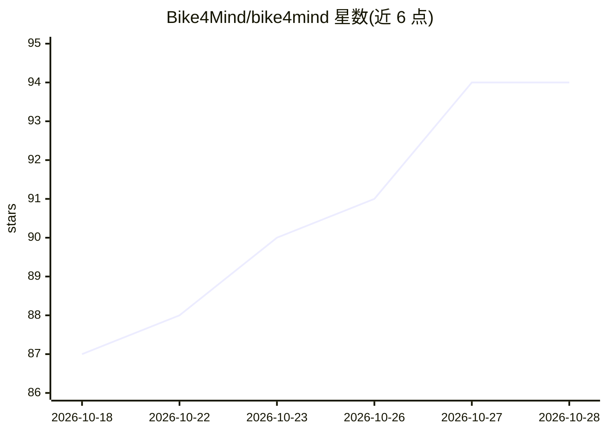

# Bike4Mind/bike4mind

⭐ 94 · TypeScript · NOASSERTION · 推送 2026-10-28 · [GitHub](https://github.com/Bike4Mind/bike4mind) · [官网](https://bike4mind.com/) · 组织维护

**开源核心的 AI 工作台：notebook、agent、RAG、多模型接入**

面向用户的 AI 知识平台，提供 notebooks 工作区、自主 ReAct agent、Quest Master 多步任务规划、RAG 知识引擎与 artifact 发布层；可在 Anthropic、OpenAI、Google Gemini、xAI、Ollama 等模型间切换，并支持图像模型。开源核心（BUSL-1.1，两年后转为 Apache-2.0）可 Docker 自托管，含 app、MongoDB、对象存储与队列；多租户托管服务为商业闭源部分。开发侧为 pnpm + Turborepo monorepo（Node 24）。

## 筛选速览

| 维度 | 判定 | 备注 |
|---|---|---|
| AI 角色 | `ai-native` | 本体是模型或模型工具 |
| 许可风险 | `none` | NOASSERTION |
| 部署形态 | `self-host` | docker 或自建部署 |
| 模型依赖 | local-ok | 支持本地模型 |
| 硬件要求 | — | 无带数字的原话,不猜 |
| 安装摩擦 | `low` | 无编译、无系统依赖或容器化 |
| 成熟度 | — | 结构信号不足 |

## 能力要点

- notebook/agent/RAG/图像生成集成于单一工作区
- 多模型切换：Anthropic、OpenAI、Gemini、xAI、Ollama 本地等
- Quest Master 多步任务规划，支持并行与 human-in-the-loop
- Docker Compose 自托管全栈（app + MongoDB + 对象存储 + 队列）

## 适用场景

- 在一个工作区里跨多模型做笔记、对话与文档处理
- 让自主 agent 基于 RAG 知识库执行多步任务
- 自托管部署于自己的硬件，数据不出本地基础设施

## 场景标签

`RAG` `知识库管理` `图像生成` `AI 助手` · 领域:对话与助手

## 证据(README 行号)

> L5: An open-core AI knowledge platform — a multi-model workspace where notebooks, autonomous agents, and a RAG knowledge
> L16: - **Notebooks** — the core workspace: chat, documents, and context in one place, across any model.
> L19: - **AI Agents** — autonomous ReAct-style agents that carry out complex tasks against your tools and knowledge.

## 星数曲线

2026-10-18 87 → 2026-10-28 94（+7）

---
*卡片 v1 · prompt 1.4 · 生成 2026-10-23 · 置信度 high · 依据 README sha `36dbb03e6bf6` · [字段定义](../../DATASET.md)*
