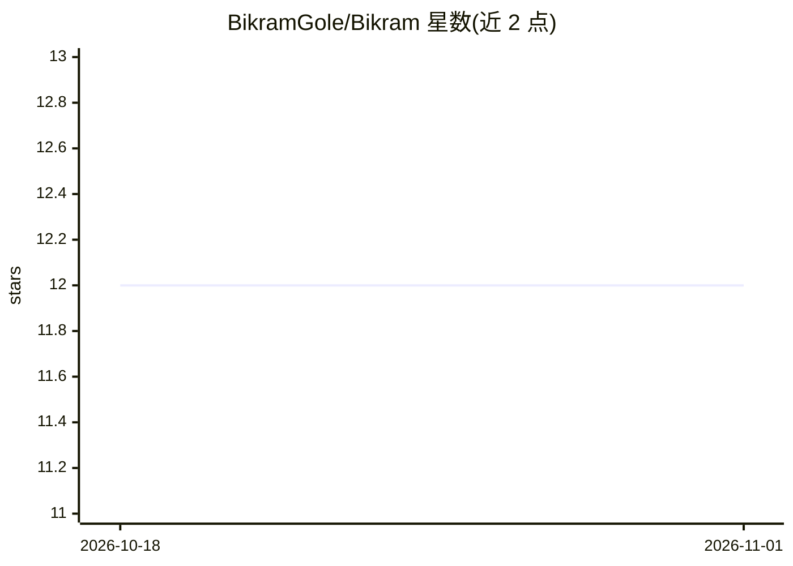

# BikramGole/Bikram

⭐ 12 · HTML · 推送 2026-10-15 · [GitHub](https://github.com/BikramGole/Bikram) · [官网](https://bikramgole.com.np) · 个人维护

**个人作品集网站：多页导航、多主题与互动终端小游戏**

面向访问者展示作者个人品牌的静态网站，部署在 GitHub Pages。功能包括 Home/About/Contact 多页导航、含主题持久化的动态主题引擎（Liquid Glass、Black Flag Uprising 等多种视觉风格）、可交互的迷你命令行终端、Persona 测验游戏、经 GitHub API 实时拉取的仓库卡片以及彩蛋等动态效果。技术栈为 HTML/CSS/原生 JavaScript，本地运行通过 git clone 后以 python -m http.server 提供服务。项目声明为 unlicense。

## 筛选速览

| 维度 | 判定 | 备注 |
|---|---|---|
| AI 角色 | `ai-enhanced` | 去掉 AI 部分产品仍成立 |
| 许可风险 | `none` | — |
| 部署形态 | `None` |  |
| 模型依赖 | — | README 未给出锁定关系 |
| 硬件要求 | — | 无带数字的原话,不猜 |
| 安装摩擦 | `low` | 无编译、无系统依赖或容器化 |
| 成熟度 | — | 结构信号不足 |

## 能力要点

- 多视觉风格的动态主题引擎，跨页面持久化
- 交互式迷你终端与 Persona 测验游戏
- GitHub API 实时拉取并展示仓库卡片
- 主题状态经 URL 参数与 localStorage 管理

## 适用场景

- 浏览作者的个人介绍、项目与技术展示
- 作为 GitHub Pages 静态个人网站的实现参考

## 场景标签

 · 领域:个人网站/作品集

## 证据(README 行号)

> L1: # Bikram Gole - The Aura Website

## 星数曲线

2026-10-18 12 → 2026-11-01 12（+0）

---
*卡片 v1 · prompt 1.4 · 生成 2026-11-01 · 置信度 low · 依据 README sha `8d9fcfda2e3c` · [字段定义](../../DATASET.md)*
