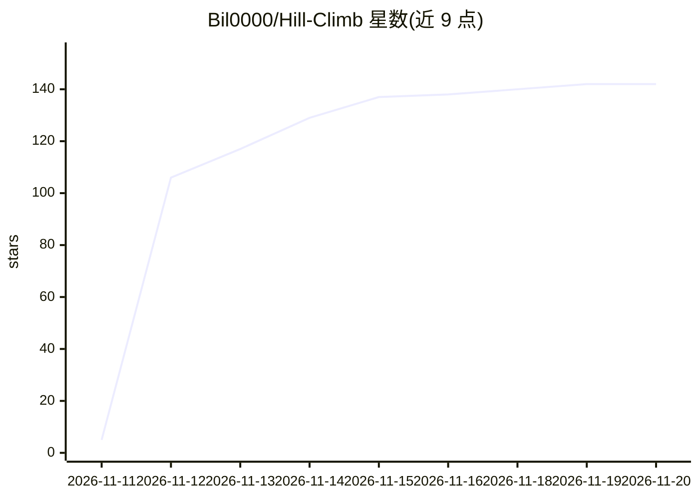

# Bil0000/Hill-Climb

⭐ 142 · Python · MIT · 推送 2026-11-12 · [GitHub](https://github.com/Bil0000/Hill-Climb) · 个人维护

**让编码 agent 用评分命令证明"完成"的技能与脚本**

面向 Claude Code、Codex 等使用 SKILL.md 的编码代理的技能包，附带单个 Python 文件 climb.py 作为评分器：代理以小步修改代码，每步由锁定的检查命令打分，分数提升且守护检查通过才提交，否则回滚；修改被锁定测试文件会被拒绝。目标以数值表达（失败测试数、毫秒、字节数等），支持多仓库并行检查、配对计时、holdout 防过拟合与可复用检查套件。需 Python 3.9+ 和 git，无其他依赖。

## 筛选速览

| 维度 | 判定 | 备注 |
|---|---|---|
| AI 角色 | `ai-ecosystem` | LLM/agent 周边工具 |
| 许可风险 | `permissive` | MIT |
| 部署形态 | `library` | 以包/库形式分发 |
| 模型依赖 | locked-api |  |
| 硬件要求 | — | 无带数字的原话,不猜 |
| 安装摩擦 | `low` | 无编译、无系统依赖或容器化 |
| 成熟度 | — | 结构信号不足 |

## 能力要点

- 仅提交分数提升且守护检查通过的步骤，其余自动回滚
- 对测试/基准/fixture 文件加锁并哈希校验，拒绝修改检查本身
- 状态记录在磁盘而非上下文中，可在压缩/崩溃后延续
- 支持多仓库、并行检查、配对计时与 holdout 防过拟合

## 适用场景

- 让 agent 逐项修复审计发现并自动保留有效提交
- 优化性能或包体积等可量化目标并防止回归
- 跨多仓库重构时自动守护旧功能

## 场景标签

`编码 Agent` · 领域:编码与开发

## 证据(README 行号)

> L33: Hill Climb is a skill for agents and a single Python file that keeps the score. The agent changes code. The script 
> L87: The agent never writes a score itself. It never decides that a step "basically" passed. The script measures, and th

## 星数曲线

2026-11-11 5 → 2026-11-20 142（+137）

---
*卡片 v1 · prompt 1.4 · 生成 2026-11-17 · 置信度 mid · 依据 README sha `23bdb1aff920` · [字段定义](../../DATASET.md)*
