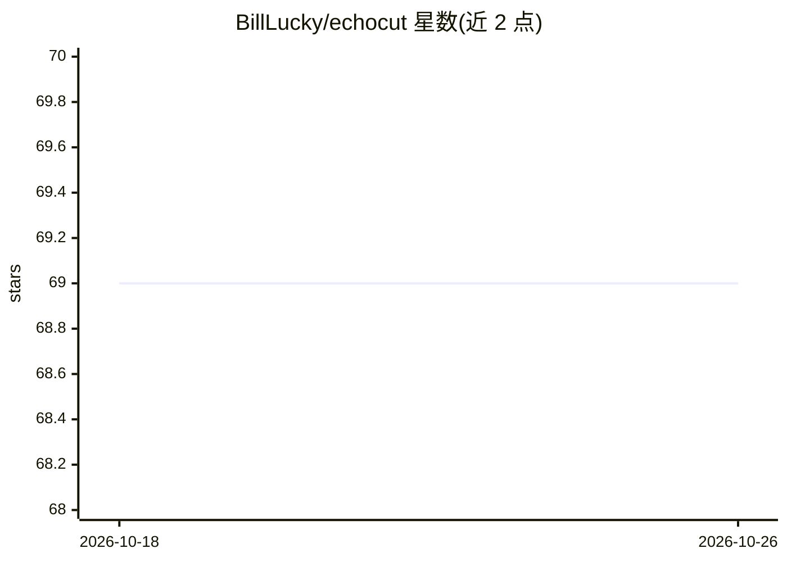

# BillLucky/echocut

⭐ 69 · JavaScript · Apache-2.0 · 推送 2026-06-23 · [GitHub](https://github.com/BillLucky/echocut) · [官网](https://github.com/BillLucky/echocut) · 个人维护 · 中文 README

**本地优先的视频 CLI：转录、加字幕、品牌包装、多平台成片**

echocut 是一个在本地机器上运行的命令行视频处理工具：给定视频后自动完成语音转录（WhisperX 跨平台；Qwen3/MLX 仅 Apple Silicon）、烧录大号可读字幕、添加品牌条与封面、按需切除语气词与静音、切分高光片段，并生成多平台标题/描述/标签的发布包。封面、颜色、CTA、LLM persona 等品牌配置以单个 JSON 文件定义。LLM 部分通过 Ollama 本地运行（标题生成、字幕修正）。提供 burn/highlights/translate/article 等多组子命令，附带中文 README 与国内镜像安装选项。

## 筛选速览

| 维度 | 判定 | 备注 |
|---|---|---|
| AI 角色 | `ai-native` | 本体是模型或模型工具 |
| 许可风险 | `permissive` | Apache-2.0 |
| 部署形态 | `library` | 以包/库形式分发 |
| 模型依赖 | local-ok | 支持本地模型 |
| 硬件要求 | — | 无带数字的原话,不猜 |
| 安装摩擦 | `medium` | 含编译或系统依赖之一 |
| 成熟度 | — | 结构信号不足 |

## 能力要点

- 词级 ASR 转录并烧录字幕，支持 WhisperX（CPU/CUDA）与 Apple Silicon 的 Qwen3/MLX 引擎
- 视频轨级别的语气词/静音切除，音画与字幕保持同步
- 品牌配置以单 JSON 文件定义，每帧绘制 @brand 胶囊标记
- 长视频支持分块转录断点续跑与跨运行转录缓存

## 适用场景

- 把口播视频一键做成带字幕、品牌条和封面的多平台成片
- 长视频自动切分高光片段并生成各平台发布文案
- 国内网络环境下用镜像脚本完成整套安装

## 场景标签

`语音识别` `图像视频处理` `AI 写作` · 领域:内容生成

## 证据(README 行号)

> L12: `echocut` is a **local-first** video CLI. Point it at a video and it transcribes the
> L26: |🎬|**Subtitle burn-in** — word-level ASR (WhisperX cross-platform; Qwen3/MLX on Apple Silicon), large readable capt
> L44: |**Ollama**|local LLM (titles, caption fixes)|<https://ollama.com> → `ollama pull qwen3.5:9b`|

## 星数曲线

2026-10-18 69 → 2026-10-26 69（+0）

---
*卡片 v1 · prompt 1.4 · 生成 2026-10-24 · 置信度 mid · 依据 README sha `8d5c84655383` · [字段定义](../../DATASET.md)*
