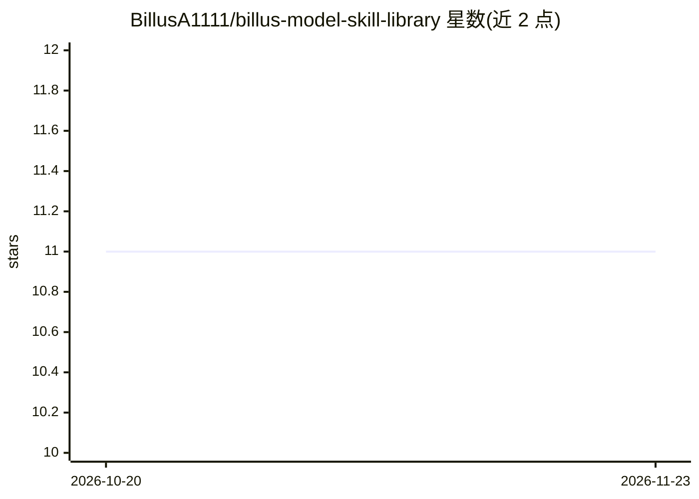

# BillusA1111/billus-model-skill-library

⭐ 11 · Python · Apache-2.0 · 推送 2026-03-12 · [GitHub](https://github.com/BillusA1111/billus-model-skill-library) · 个人维护 · 中文 README

**Codex 模型工程技能库：辅助 LLM/VL/扩散模型训练调参**

面向 Codex 的技能仓库，核心技能 billus-model-ops 让 agent 进入训练仓库后先识别实际框架路径（Trainer/Accelerate/DeepSpeed/FSDP），再做最小变更与风险交付。覆盖 LLM 训练调参剪枝量化、VL 视觉塔与 projector 改动、diffusers 图像生成链路检查，附带训练栈检测、实验计划生成、训练日志总结三个辅助脚本，另有 diffusion-pipe 自动训练技能与规划中的数据集自动化路线。

## 筛选速览

| 维度 | 判定 | 备注 |
|---|---|---|
| AI 角色 | `ai-knowledge` | 知识聚合/清单类 |
| 许可风险 | `permissive` | Apache-2.0 |
| 部署形态 | `None` |  |
| 模型依赖 | — | README 未给出锁定关系 |
| 硬件要求 | — | 无带数字的原话,不猜 |
| 安装摩擦 | `low` | 无编译、无系统依赖或容器化 |
| 成熟度 | — | 结构信号不足 |

## 能力要点

- billus-model-ops 技能：识别训练仓库真实框架后做最小变更
- 附 detect_training_stack / new_experiment_note / summarize_training_log 三个脚本
- 覆盖 PEFT/LoRA/QLoRA 与 bitsandbytes 低比特训练栈
- diffusion-pipe-auto-train 提供面向 diffusion-pipe 的配置生成与启动编排

## 适用场景

- 让 Codex 安全修改训练参数而不破坏 launch/resume 流程
- 定位训练仓库使用的是 Trainer、Accelerate、DeepSpeed 还是 FSDP
- 评估 VL 项目 projector 改动对 image token 对齐的影响

## 场景标签

`微调` `模型量化` `图像生成` `多模态` · 领域:内容生成

## 证据(README 行号)

> L3: 面向真实模型工程工作的 Codex 技能仓库，重点服务这些场景：
> L16: `billus-model-ops` 不是泛泛的“模型知识摘要”，而是面向仓库落地的模型工程技能。它的目标是让 Codex 在进入训练仓库后，先识别真实框架路径，再做最小变更、最小验证、最清晰的风险交付。

## 星数曲线

2026-10-20 11 → 2026-11-23 11（+0）

---
*卡片 v1 · prompt 1.4 · 生成 2026-11-19 · 置信度 high · 依据 README sha `4371946410e9` · [字段定义](../../DATASET.md)*
