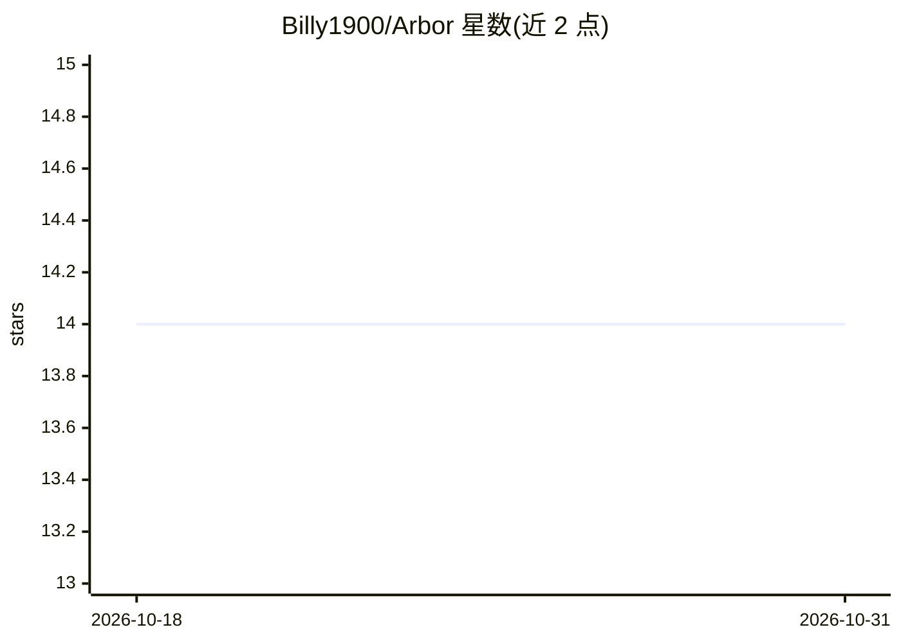

# Billy1900/Arbor

⭐ 14 · Rust · MIT · 推送 2026-06-16 · [GitHub](https://github.com/Billy1900/Arbor) · [官网](https://billy1900.github.io/Arbor/) · 个人维护

**面向智能体 RL 训练的自托管 Firecracker 执行后端**

用 Rust 基于 Firecracker 构建的 coding-agent 强化学习执行层：支持任务中途快照、从 checkpoint 分叉出 N 个统计独立的 rollout 环境（各自独立的 PRNG 种子、令牌与凭据），提供 per-step 轨迹追踪（M10）、checkpoint DAG、VPC 内的凭据代理与默认拒绝出网策略，可导出 JSONL 轨迹用于微调。面向 VeRL、OpenRLMF、TRL 等 RL 框架的开发者，替代临时 subprocess/Docker 方案。需 Linux KVM 主机、Docker 与 Firecracker 二进制，支持 Docker Compose、Helm/K8s 与单节点手动部署，仅支持完整 VM 快照（diff 快照待 Firecracker GA）。

## 筛选速览

| 维度 | 判定 | 备注 |
|---|---|---|
| AI 角色 | `ai-ecosystem` | LLM/agent 周边工具 |
| 许可风险 | `permissive` | MIT |
| 部署形态 | `self-host` | docker 或自建部署 |
| 模型依赖 | local-ok | 支持本地模型 |
| 硬件要求 | — | 无带数字的原话,不猜 |
| 安装摩擦 | `low` | 无编译、无系统依赖或容器化 |
| 成熟度 | `idea` | |

## 能力要点

- checkpoint 分叉：每个 fork 获独立熵、令牌与身份，无共享 PRNG 状态
- M10 轨迹追踪层：prompt→tool call→diff→reward，跨 fork 对比与奖励归因
- 凭据不进入 VM：宿主机侧代理注入，结构性 default-deny 出网
- 支持 llama.cpp / vLLM 宿主侧 GPU 推理 sidecar（gpu.local）

## 适用场景

- 为 GRPO/PPO 组采样提供 N 个独立 rollout 环境
- 在自有 VPC 内运行 SWE-bench 式 agent 训练，轨迹不离集群
- 对失败的 agent 执行轨迹做分叉回放与归因分析

## 场景标签

`强化学习` · 领域:训练与推理

## 证据(README 行号)

> L8: **The execution backend for agentic RL rollouts. Works with VeRL, OpenRLHF, TRL, and any framework that needs isolat
> L30: Arbor is designed to be the **execution backend for RL rollout workers** in frameworks like VeRL, OpenRLHF, and TRL

## 星数曲线

2026-10-18 14 → 2026-10-31 14（+0）

---
*卡片 v1 · prompt 1.4 · 生成 2026-10-31 · 置信度 high · 依据 README sha `91f5e695dfd0` · [字段定义](../../DATASET.md)*
