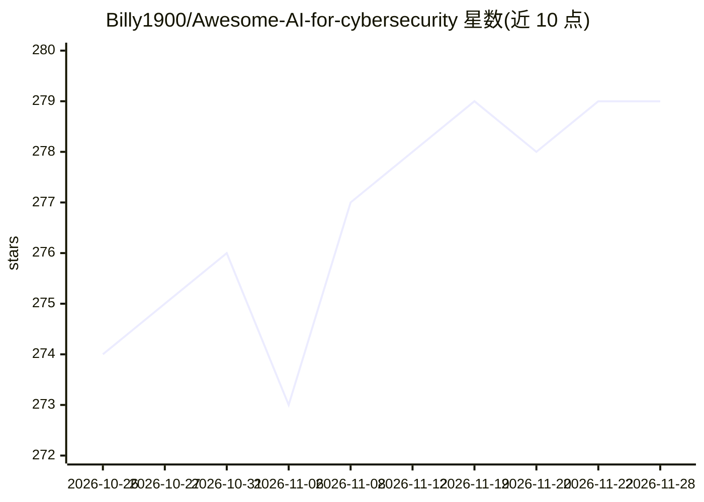

# Billy1900/Awesome-AI-for-cybersecurity

⭐ 279 · 推送 2026-11-27 · [GitHub](https://github.com/Billy1900/Awesome-AI-for-cybersecurity) · 个人维护

**面向网络安全从业者的 AI 应用论文与工具清单**

按 PPDR 五类任务与五个技术层组织的安全 AI 资源聚合清单：覆盖网络流量分析/入侵检测、终端反恶意软件、应用安全（WAF）、用户行为分析、流程行为反欺诈与 IDS/IPS，每层给出适用的回归/分类/聚类任务说明及可参考的论文与书籍；另列 AI 安全 agent、LLM 应用防火墙等工具条目，部分条目附许可信息。定位为知识导航资源，供安全与 ML 方向的初学者和开发者按层检索材料。

## 筛选速览

| 维度 | 判定 | 备注 |
|---|---|---|
| AI 角色 | `ai-knowledge` | 知识聚合/清单类 |
| 许可风险 | `none` | — |
| 部署形态 | `self-host` | docker 或自建部署 |
| 模型依赖 | — | README 未给出锁定关系 |
| 硬件要求 | — | 无带数字的原话,不猜 |
| 安装摩擦 | `low` | 无编译、无系统依赖或容器化 |
| 成熟度 | — | 结构信号不足 |

## 能力要点

- 按 PPDR 五类任务与网络/终端/应用/用户/流程五层组织条目
- 每层给出回归/分类/聚类的具体安全任务示例
- 收录 AI 安全 agent 与 LLM 应用防火墙等开源条目
- 附书籍与综述论文章节供进阶阅读

## 适用场景

- 为入侵检测方向找入门论文与综述
- 了解机器学习在反恶意软件和反欺诈中的应用任务
- 查找 AI 安全 agent 与 LLM 防火墙等开源工具

## 场景标签

`网络安全` `精选清单` · 领域:学习与行业

## 证据(README 行号)

> L1: # Awesome AI for cybersecurity
> L2: This is a list of AI for cybersecurity, including **network** (network traffic analysis and intrusion detection), **

## 星数曲线

2026-10-26 274 → 2026-11-28 279（+5）

---
*卡片 v1 · prompt 1.4 · 生成 2026-11-28 · 置信度 mid · 依据 README sha `34c9e0ca8ae5` · [字段定义](../../DATASET.md)*
