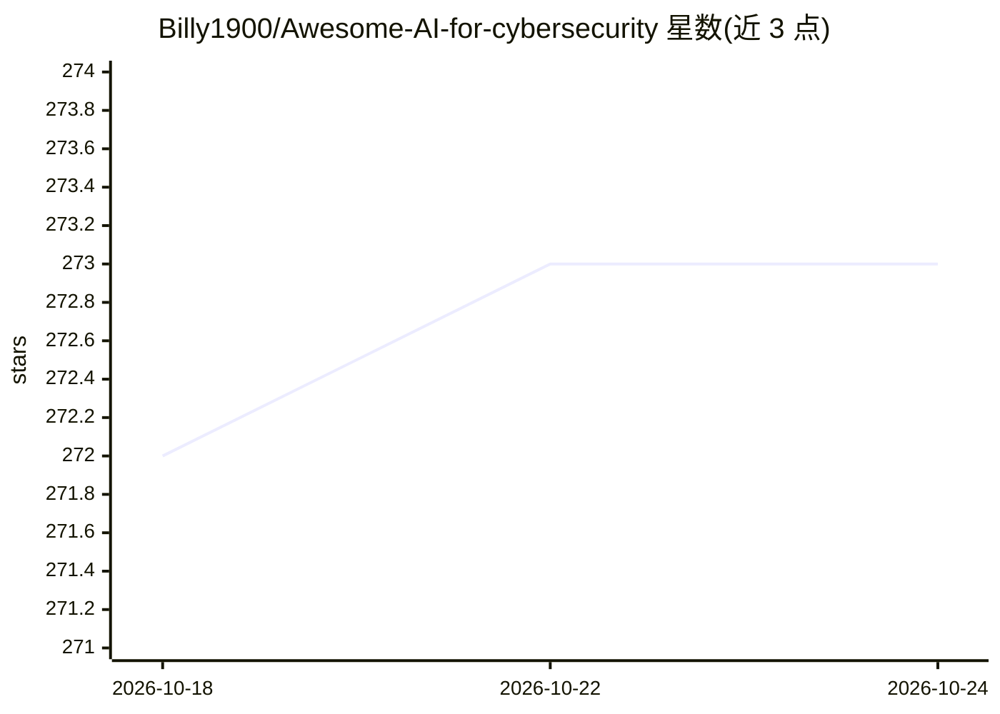

# Billy1900/Awesome-AI-for-cybersecurity

⭐ 273 · 推送 2026-10-02 · [GitHub](https://github.com/Billy1900/Awesome-AI-for-cybersecurity) · 个人维护

**AI 网络安全应用策展清单：覆盖五层安全场景的论文与工具**

按 PPDR 模型（预测/防护/检测/响应/监控）与技术层次组织的 AI 网络安全知识清单：网络流量分析与入侵检测、终端反恶意软件、应用安全（WAF/数据库防火墙）、用户行为分析（UBA）、过程行为反欺诈。每个类别说明 ML 任务（回归/分类/聚类）并罗列研究论文，另收录 AI 安全 Agent、LLM 应用防火墙条目及相关书籍与综述。面向安全方向开发者和研究人员做文献与工具导航。

## 筛选速览

| 维度 | 判定 | 备注 |
|---|---|---|
| AI 角色 | `ai-knowledge` | 知识聚合/清单类 |
| 许可风险 | `none` | — |
| 部署形态 | `self-host` | docker 或自建部署 |
| 模型依赖 | — | README 未给出锁定关系 |
| 硬件要求 | — | 无带数字的原话,不猜 |
| 安装摩擦 | `low` | 无编译、无系统依赖或容器化 |
| 成熟度 | — | 结构信号不足 |

## 能力要点

- 按技术层次（网络/终端/应用/用户/过程）组织的安全 AI 条目
- 每个类别附研究论文与书籍、综述清单
- 收录 AI 安全 Agent 与 LLM 应用防火墙条目

## 适用场景

- 查找各安全层次的 AI 方法与入门论文
- 了解入侵检测、恶意软件分类等任务中的 ML 应用方式
- 发现开源 AI 安全 Agent 与防火墙工具

## 场景标签

`网络安全` `精选清单` · 领域:学习与行业

## 证据(README 行号)

> L1: # Awesome AI for cybersecurity
> L11: The first dimension is a goal or a task. According to Gartner’s PPDR model, all security tasks can be divided into 

## 星数曲线

2026-10-18 272 → 2026-10-24 273（+1）

---
*卡片 v1 · prompt 1.4 · 生成 2026-10-22 · 置信度 mid · 依据 README sha `074331f70e29` · [字段定义](../../DATASET.md)*
