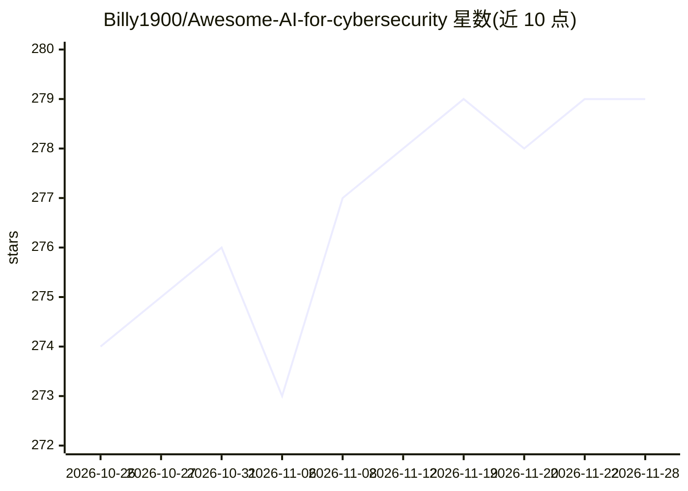

# Billy1900/Awesome-AI-for-cybersecurity

⭐ 279 · 推送 2026-11-27 · [GitHub](https://github.com/Billy1900/Awesome-AI-for-cybersecurity) · 个人维护

**网络安全领域 AI 应用与论文的策展清单**

按 PPDR 任务维度（预测/预防/检测/响应/监控）与技术层维度（网络、终端、应用、用户、进程行为）组织的网络安全 AI 资源清单。每个层级列出 ML 任务形式（回归/分类/聚类）与对应研究论文、书籍和综述，另收录 AI 防火墙中间件、AI 安全 Agent、渗透测试平台等开源项目的条目，附许可证与功能简介。

## 筛选速览

| 维度 | 判定 | 备注 |
|---|---|---|
| AI 角色 | `ai-knowledge` | 知识聚合/清单类 |
| 许可风险 | `none` | — |
| 部署形态 | `self-host` | docker 或自建部署 |
| 模型依赖 | — | README 未给出锁定关系 |
| 硬件要求 | — | 无带数字的原话,不猜 |
| 安装摩擦 | `low` | 无编译、无系统依赖或容器化 |
| 成熟度 | — | 结构信号不足 |

## 能力要点

- 五层技术维度组织：网络/终端/应用/用户/进程行为
- 每个层级给出回归/分类/聚类的 ML 任务拆解
- 收录 AI 防火墙与 AI 安全 Agent 等开源项目条目
- 附书籍与综述论文阅读清单

## 适用场景

- 为入侵检测/恶意软件分类等方向查找入门论文
- 调研各安全层级可用的机器学习方法
- 查找 AI 安全 Agent 与 LLM 防火墙类开源项目

## 场景标签

`精选清单` `网络安全` · 领域:学习与行业

## 证据(README 行号)

> L1: # Awesome AI for cybersecurity
> L2: This is a list of AI for cybersecurity, including **network** (network traffic analysis and intrusion detection), **
> L33: And here are some research papers:

## 星数曲线

2026-10-26 274 → 2026-11-28 279（+5）

---
*卡片 v1 · prompt 1.4 · 生成 2026-11-26 · 置信度 mid · 依据 README sha `a3c374a94fc6` · [字段定义](../../DATASET.md)*
