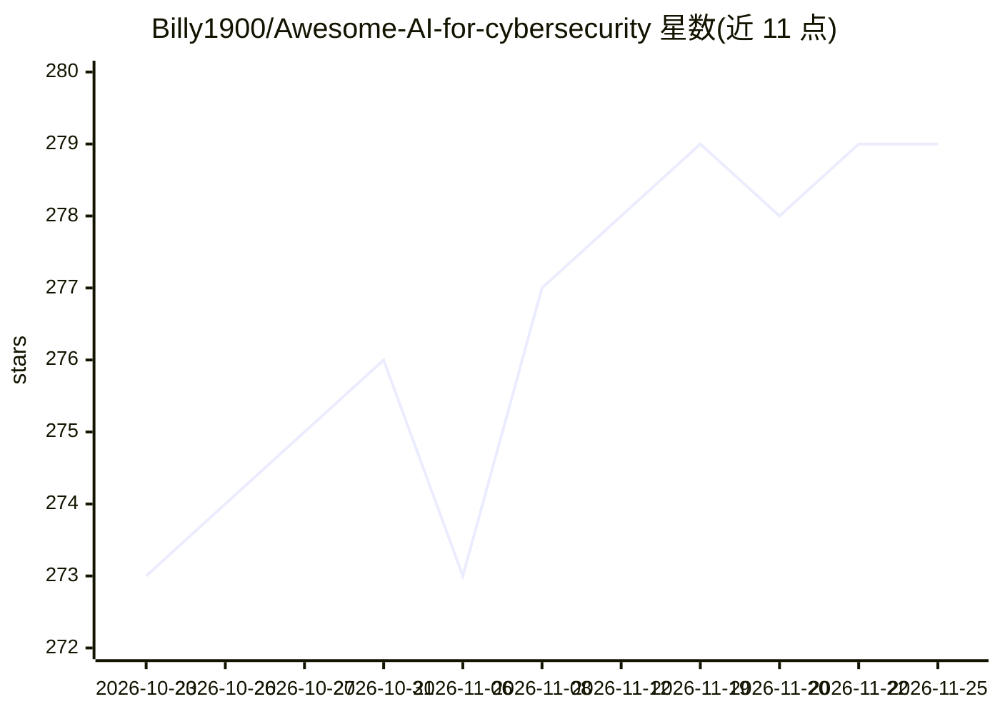

# Billy1900/Awesome-AI-for-cybersecurity

⭐ 279 · 推送 2026-11-13 · [GitHub](https://github.com/Billy1900/Awesome-AI-for-cybersecurity) · 个人维护

**面向网络安全从业者的 AI 应用与论文整理清单**

一份按网络安全领域组织的 AI 资源清单，覆盖网络流量分析与入侵检测、终端反恶意软件、应用层 WAF/代码分析、用户行为分析（UBA）、进程行为反欺诈五个技术层，并按 Gartner PPDR 模型的预测/预防/检测/响应/监控五类任务组织内容。各章节给出回归/分类/聚类等机器学习任务示例，并罗列相关研究论文、书籍与综述；另收录行为安全决策模型、LLM 应用防火墙与 AI 安全 Agent 等开源项目条目。

## 筛选速览

| 维度 | 判定 | 备注 |
|---|---|---|
| AI 角色 | `ai-knowledge` | 知识聚合/清单类 |
| 许可风险 | `none` | — |
| 部署形态 | `self-host` | docker 或自建部署 |
| 模型依赖 | — | README 未给出锁定关系 |
| 硬件要求 | — | 无带数字的原话,不猜 |
| 安装摩擦 | `low` | 无编译、无系统依赖或容器化 |
| 成熟度 | — | 结构信号不足 |

## 能力要点

- 按网络/终端/应用/用户/进程五层组织 AI 安全资源
- 按 PPDR 模型五类任务划分安全目标
- 收录 LLM 应用防火墙与 AI 安全 Agent 开源项目
- 附带书籍与综述论文列表

## 适用场景

- 查找入侵检测、恶意软件分类方向的研究论文
- 了解 AI 在各网络安全层面的应用任务类型
- 寻找 AI 安全 Agent 或 LLM 防火墙相关开源项目

## 场景标签

`精选清单` `网络安全` · 领域:学习与行业

## 证据(README 行号)

> L1: # Awesome AI for cybersecurity
> L2: This is a list of AI for cybersecurity, including **network** (network traffic analysis and intrusion detection), **
> L11: The first dimension is a goal or a task. According to Gartner’s PPDR model, all security tasks can be divided into 

## 星数曲线

2026-10-23 273 → 2026-11-25 279（+6）

---
*卡片 v1 · prompt 1.4 · 生成 2026-11-25 · 置信度 mid · 依据 README sha `5adac42beceb` · [字段定义](../../DATASET.md)*
